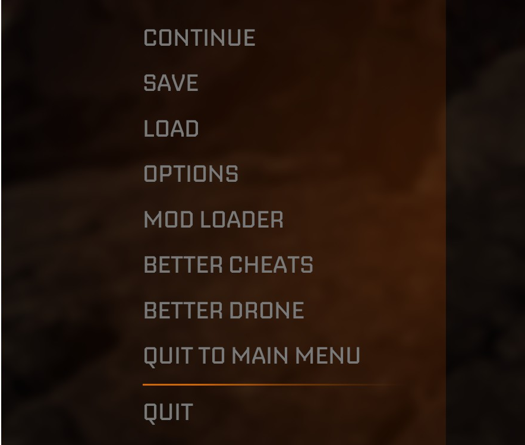
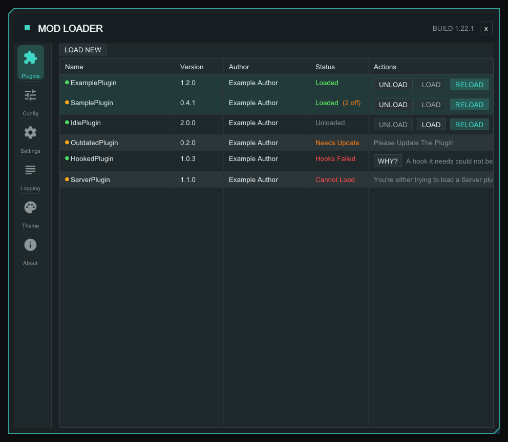
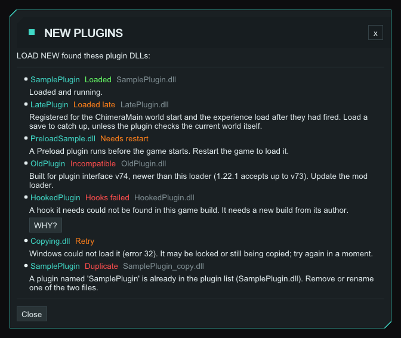
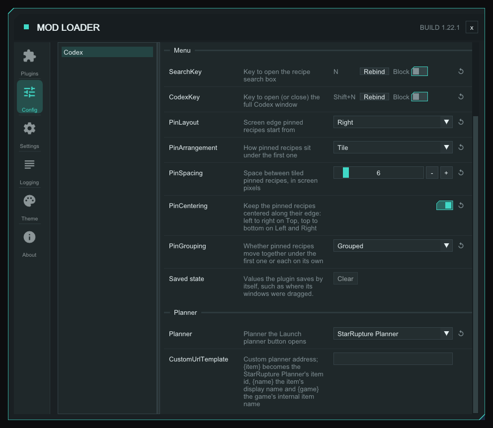
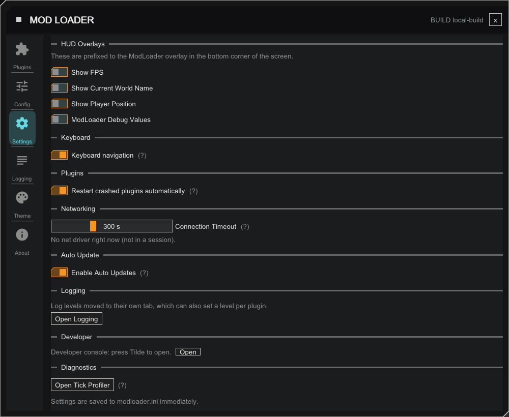
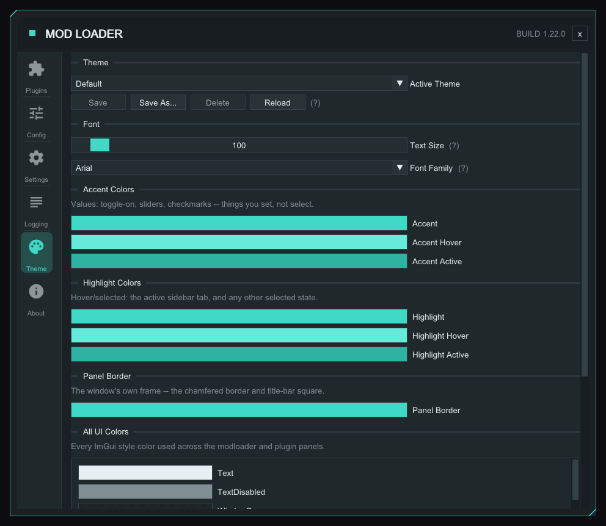
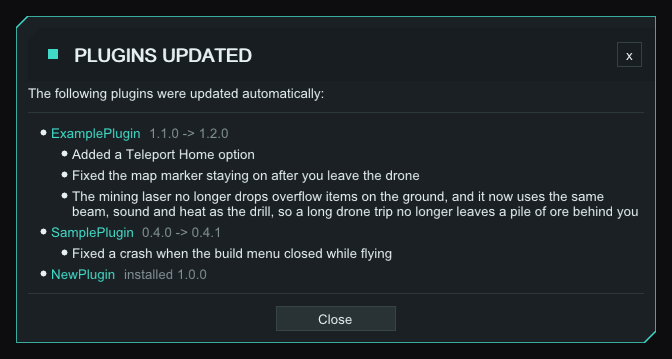
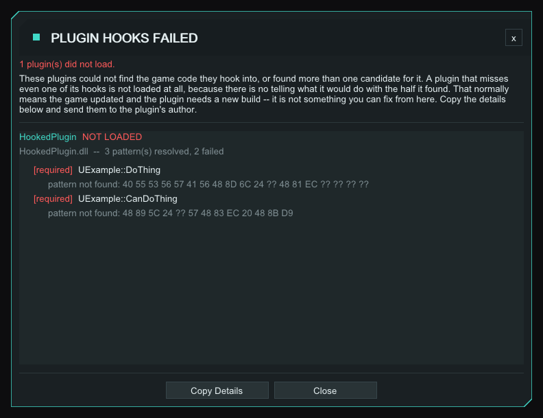
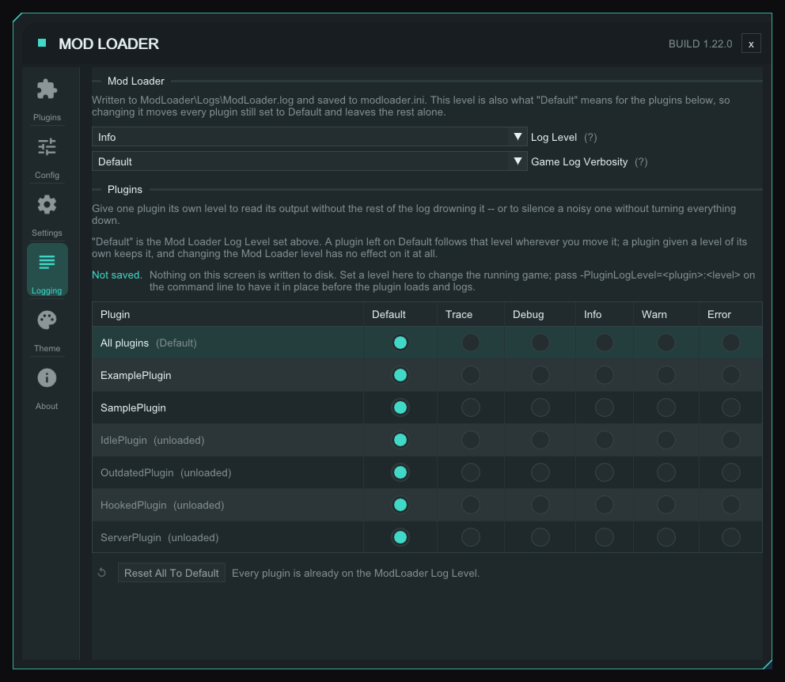

# StarRupture ModLoader
[](https://github.com/AlienXAXS/StarRupture-ModLoader/actions/workflows/release.yml)

A plugin-based mod loader for [StarRupture](https://store.steampowered.com/app/1631270/StarRupture/). Loads automatically via DLL proxy injection — no game files are modified.

Like this project? Give it a star here on GitHub!

---

## Discord

[Join our Discord server](https://discord.gg/G5a4GYsvrz) to chat about the mod loader and plugins.

Found a bug? [Report it on GitHub](https://github.com/AlienXAXS/StarRupture-ModLoader/issues) and attach your `ModLoader.log` (in `<game>\StarRupture\Binaries\Win64\ModLoader\Logs\`).

---

## Installation

### 1. Download the right ZIP

Two builds are published on the [releases page](https://github.com/AlienXAXS/StarRupture-ModLoader/releases):

| ZIP | Use for |
|---|---|
| `StarRupture-ModLoader-Client-*.zip` | Playing the game |
| `StarRupture-ModLoader-Server-*.zip` | Running a dedicated server |

### 2. Extract into the game's binary folder

That's the folder containing `StarRuptureGameSteam-Win64-Shipping.exe`, for example:

```
StarRupture\Binaries\Win64\
```

The ZIP is already laid out correctly, so extract it **directly into that folder** — no subfolders
need creating by hand. Afterwards you should see:

```
StarRupture\Binaries\Win64\
├── StarRuptureGameSteam-Win64-Shipping.exe
├── dwmapi.dll                        ← the proxy the game loads
└── ModLoader\
    ├── StarRupture-ModLoader-Core.dll   ← the mod loader itself
    ├── StarRupture-ImGui.dll            ← client builds only
    ├── StarRupture-ModLoader-Updater.exe  ← client builds only, offers mod loader updates
    ├── modloader.ini                    ← created on first launch
    ├── Logs\                            ← created on first launch
    ├── Plugins\                         ← put plugin DLLs here
    └── Preload\                         ← put preload plugin DLLs here
```

Everything the mod loader owns lives under `ModLoader\`; `dwmapi.dll` is the only file that sits
next to the game executable.

### 3. Launch as normal

The mod loader initialises automatically via `dwmapi.dll`. No game files are modified.

**Linux users:** the mod will not load unless the environment variable `WINEDLLOVERRIDES` is set to
`dwmapi=n,b`.

---

## Installing Plugins

The mod loader ships with no plugins — download the ones you want and drop their `.dll` into
`Binaries\Win64\ModLoader\Plugins\`. Client plugins only load on a client, server plugins only on
a dedicated server; the mod loader window says so if you get one the wrong way round.

**Plugins are disabled by default.** The first time the game runs with a plugin present, a config
file is generated for it. To enable it:

1. Run the game once, then close it.
2. Open `Binaries\Win64\ModLoader\Plugins\config\`.
3. Open the `.ini` named after the plugin.
4. Set `Enabled=1` and save.
5. Launch again — the plugin is now active.

Repeat for each plugin you want to use. On a client you can do all of this from the mod loader
window instead, without editing files.

If a plugin ships a `.json` file alongside its `.dll`, it can update itself: the mod loader checks
for a new version at startup and downloads it. The **Plugins** tab marks those with a green dot
(amber means the plugin has no update manifest and has to be updated by hand). Auto-updating can be
turned off in the **Settings** tab.

---

## The Mod Loader Window (client)

- **F2** (rebindable: `OpenKey` under `[UI]` in `modloader.ini`) opens it. So does **MOD LOADER** in the game's main and pause menus, below OPTIONS.
- **Esc** closes it. <sup>[✦](#msantoro12)</sup>
- **1** to **5** open Plugins, Config, Settings, Logging and Theme while the window has the focus. They
  do nothing while a text box, a slider drag or a keybind capture is taking keys. <sup>[✦](#msantoro12)</sup>
- **Tab**, **Shift+Tab** and the arrow keys move between buttons and fields in this window and in
  plugin windows, **Space** or **Enter** uses the one picked. It runs only while a window is open, and
  **Keyboard navigation** in the **Settings** tab turns it off. <sup>[✦](#msantoro12)</sup>
- The loader and plugin windows are drawn into the frames that frame generation makes, so they do not
  flicker, and frame generation stays on while one is open. <sup>[✦](#msantoro12)</sup>
- **`~`** (tilde; rebindable: `OpenKey` under `[Console]` in `modloader.ini`) opens the [developer console](#developer-console).



The tabs down the left are **Plugins**, **Config**, **Settings**, **Logging**, **Theme**, **Browse** and **About**
(the build tag and the plugins currently loaded). The menu row is set in
[`modloader.ini`](#modloaderini). A splash window shows startup progress. In the main menu a
bottom-left banner shows the build tag, plugin count and open key, plus a red note when an update
is available.

### Plugins tab



- **LOAD NEW**, beside the window title, picks up plugin DLLs added to the Plugins folder since the
  game started, and a popup lists each one with what to do next. <sup>[✦](#msantoro12)</sup>

  

  - **Loaded** means nothing it registered for in PluginInit had already fired (save-loaded
    callbacks are not tracked). **Loaded late** registered for a world or experience start that had
    already fired; load a save to catch it up (the any-world start also re-fires on returning to
    the main menu), unless the plugin checks the current world itself.
  - **Needs restart** is a new DLL in the Preload folder, which only loads at game start.
  - **Incompatible** is a plugin built for a newer plugin interface than this loader's (update the mod
    loader; the row says which release the plugin needs, from the latest release's plugin interface range), or, on a game build other than the one the plugin was built for, says the plugin needs an
    update (see [Game updates](#game-updates)). A plugin is never refused for an older interface; one from
    before interface v70 counts as built for a game build before CL-127004.
  - **Hooks failed** has a **WHY?** button for the [report](#pop-up-windows).
  - **Retry** is a DLL Windows could not open yet, usually still being copied or locked.
  - **Duplicate** is a plugin whose name is already in the list.
  - The `rescan` console command prints the same lines.
- Click a loaded plugin's row to open its page on the Config tab. The buttons on the row work as before. <sup>[✦](#msantoro12)</sup>
- **Cannot Load** is a server plugin on a client, or the reverse.
- **Needs Update** names the side that is behind: the plugin or the mod loader.
- **WHY?** on a Hooks Failed row reopens the [report](#pop-up-windows).
- **Loaded (2 off)** is a plugin that runs with two of its features turned off because a game
  update moved something they need. Hover the name or the count to see which. <sup>[✦](#msantoro12)</sup>
- **Crashed** is a plugin that faulted in its own code during one of its callbacks: a tick, an
  overlay panel or widget, a game event, a keybind, a console command, a network or HTTP handler.
  The loader switches that plugin off and the game keeps running. Hover the status for the fault
  code and the callback. Nothing calls into the plugin again until it is reloaded or unloaded, and
  **RELOAD** brings it back fresh. Detours it placed on game functions and threads of its own are
  not switched off, so restart the game if it still misbehaves. <sup>[✦](#msantoro12)</sup>
  - A fault in game or mod loader code still crashes the game, even when a plugin's callback called
    into it: carrying on past half-finished game code could freeze the game. The log names the
    plugin and the callback it happened under.
  - On a server, a crashed HTTP request filter denies every request until its plugin is reloaded.
  - A toast in the bottom right corner names the plugin and the callback, fades after about 7
    seconds, and stacks when several plugins crash. About 3 seconds later the loader reloads the
    plugin on its own, the same as **RELOAD**, if its [load and unload settings](#load-and-unload-settings)
    allow it: **Any time** restarts after the short wait, **Main menu only** waits until you are at the main menu,
    and a plugin that needs a game restart stays off (the toast says so). Each plugin restarts
    automatically at most 3 times a session; a fourth crash leaves it off until the game restarts.
    Every crash, planned restart, restart and give-up is in `ModLoader.log`. On a dedicated server
    there is no toast and no setting: restarts are always on, under the same rules. Nothing restarts once the game starts to exit.
    <sup>[✦](#msantoro12)</sup>
- **Return to the main menu to reload this plugin**, **This plugin requires a game restart**, **Unload
  not supported** and **Unload blocked: ...** take the place of the buttons the loader would refuse.
  They come from the plugin's own [load and unload settings](#load-and-unload-settings).
  <sup>[✦](#msantoro12)</sup>
- **This plugin is being unloaded right now** shows on a row while the plugin is inside its own
  shutdown. The loader does not hold its windows up meanwhile, so a plugin that waits for the game's
  graphics at shutdown can finish. <sup>[✦](#msantoro12)</sup>
- Unload removes the panels, widgets and callbacks the plugin registered, even ones it left
  behind.
- If the overlay is still drawing its panel after about a second, the unload is skipped and the log
  says so. The plugin is shut down and shows **Unloaded**, but its DLL stays mapped. **LOAD** or
  **RELOAD** retries.

### Load and unload settings

A plugin can say when it may be loaded and unloaded while the game runs. It declares one setting for
loading and one for unloading, each **ANYTIME**, **MENU** or **RESTART**; a reload is an unload and a
load, so it needs both. <sup>[✦](#msantoro12)</sup>

| Setting | Load | Unload (and reload) |
|---|---|---|
| ANYTIME | Any time. The default, and what every plugin built before this reads as | Any time |
| MENU | Only while no game world is running (the splash or the main menu) | Only while no game world is running |
| RESTART | Only when the loader loads plugins at startup | Never at run time: **Unload not supported** |

The loader refuses before it touches the plugin, from every path: the buttons, **LOAD NEW**, the
`reload`, `unload`, `load` and `rescan` commands (including `all`) and a command run through RCON or
Server Utility. The reason is on the plugin's row and in the command's output:

- MENU in a world: "Return to the main menu to reload this plugin".
- RESTART: "This plugin requires a game restart".

A plugin can also mark itself busy for a while, such as MiniMap with GPU work in flight. The loader
then refuses an unload or a reload with **Unload blocked: &lt;reason&gt;**, and the plugin keeps running.
It never calls the plugin to ask. Game shutdown ignores all of it.

A world is running from the moment ChimeraMain begins play until it ends; the main menu and the
splash have none. How a plugin declares these is in the SDK's `PluginDevelopment.md`.

### Config tab



- **Ctrl+Click** a slider to type an exact value.
- **-** and **+** beside a slider step it by 1 (decimal: 1% of range). **Ctrl** steps 10%. They
  repeat while held. <sup>[✦](#msantoro12)</sup>
- A number field applies as you type; a text field on **Enter** or when you click away.
- **Rebind** waits for the next key; hold Ctrl, Shift or Alt for a combo, **Esc** cancels. No
  keybind fires meanwhile.
- Press and release a modifier alone to bind just that modifier. <sup>[✦](#msantoro12)</sup>
- **Block** stops the game also reacting to the combo.
- A setting with a fixed set of choices is a dropdown. <sup>[✦](#msantoro12)</sup>
- A setting that belongs to a turned-off feature is greyed out. Hover it for the reason; its value
  is kept, and it works again when the feature does. <sup>[✦](#msantoro12)</sup>
- **Saved state** stands for values a plugin keeps by itself, such as where its windows were
  dragged. **Clear** puts them back to their defaults. <sup>[✦](#msantoro12)</sup>
- The reset arrow restores the default. A plugin's `[General] Enabled` has none, nor does a
  setting without a default.
- The plugin hears each change as you make it. The `.ini` is written when you let go of a slider
  or confirm a value. A value a plugin writes to its own `.ini` shows at once, and Reload picks up
  settings the new build added.

### Settings tab



- The HUD toggles share one draggable box. It starts at the top left and remembers where you put
  it. **ModLoader Debug Values** adds input details to it ([Troubleshooting](#troubleshooting)).
- **Keyboard navigation** (on by default) lets Tab, the arrow keys and Space or Enter drive the loader
  and plugin windows while they are open. <sup>[✦](#msantoro12)</sup>
- **Restart crashed plugins automatically** (on by default) reloads a [crashed](#plugins-tab) plugin
  a few seconds after its crash toast. Turn it off to restart them yourself with **RELOAD**.
  <sup>[✦](#msantoro12)</sup>
- **Preload images from the game** (off by default) lets the loader read the item and building images
  that mods list, in the background, before they are drawn. See [Image library](#image-library).
  <sup>[✦](#msantoro12)</sup>
- **Clear image cache** (a button under **Preload images from the game**) deletes the images the
  loader saved to disk, for every game build. Pictures already loaded stay for this session, and the
  next launch saves them again. <sup>[✦](#msantoro12)</sup>
- **Connection Timeout**: see [Net timeouts](#net-timeouts).
- **Enable Auto Updates** takes effect next launch. A mod loader update asks Yes or No first; a No
  is remembered for that version.
- **Open Tick Profiler**: **Log Tick Stutters** and **Stack Sample Stutters** reset on restart.
  Stack sampling needs stutter logging on and is the heavier of the two.

### Theme tab



- **Save**, **Save As...**, **Delete** and **Reload** manage `ModLoader\Themes\<name>.ini`; share the
  file to share the theme. **Default** and **Star Rupture** are built in and read-only: **Save As...**
  makes an editable copy. <sup>[✦](#msantoro12)</sup>
- Colour edits apply at once; **Save** keeps them and **Reload** discards them.
- **Font Family** only lists fonts found on your PC. Microsoft YaHei, Meiryo, Malgun Gothic and
  Arial + CJK add Chinese, Japanese or Korean text.

### Browse tab <sup>[✦](#msantoro12)</sup>

Lists plugins from the mod index. Each row shows the plugin's name, summary, version and author, an
**Installed** marker when a plugin of that name is loaded, and an **Open page** button that opens the
plugin's page (Nexus Mods or GitHub) in your browser. The list is downloaded once, the first time you
open the tab, and kept until the game closes. If the download fails, the tab says so and **Retry** tries
again. The tab only lists plugins; it never downloads or installs one. The format of the index and how to
add a plugin are in [`mod-index/README.md`](mod-index/README.md).

### Image library <sup>[✦](#msantoro12)</sup>

Mods that show item or building pictures (an item list, a tooltip, a build menu) get them from one
place in the loader instead of each copying game textures itself. A mod reaches it through
`IPluginImages` (plugin interface v77, ModLoader 1.24.0 or newer); mods that do not use it keep copying as before.

- A picture is read from the game only when a mod is about to show it. Opening a window does not
  read the pictures behind it.
- Each picture is stored at 256 px at most; a smaller one keeps its own size. The stored copies are
  capped at 256 MB, or a small share of your video memory if that is less. When the cap is reached the
  pictures shown longest ago go first.
- Mods that use the image library read game pictures through one shared read that checks the game's
  texture before it is copied.
- A picture is saved to disk after the first time it is read, in `ModLoader\image-cache\`. On later
  launches it loads from there instead of from the game. The folder belongs to one game build and one
  set of mod paks, so a game update, or a mod pak that changed or moved in the load order, starts a new
  folder. At each launch the loader keeps the folder in use and the newest earlier one, removes the
  others, and trims what is left to 256 MB, the pictures used longest ago first. Pictures of textures the game makes while it runs are not saved.
  If a mod mounts a pak after the game has started, saved pictures are not used for the rest of that
  launch.
- **Preload images from the game** in the [Settings tab](#settings-tab) is off by default. On, the
  loader reads the pictures that mods list from the game one at a time, and pauses while a picture on
  screen is waiting or video memory is short. The **Clear image cache** button is under it.
- On a game build whose version object map (v map) has no rows for the texture layout, pictures show as
  placeholders. See [VersionMap.md](VersionMap.md#native-members-the-image-library-reads).

### Developer console

**`~`** opens it over the top of the screen; it takes game input while open. Up and Down walk your
history. A line the mod loader does not know goes to the game's own console; prefix `!` to send it
there only. See [Console commands](#console-commands).

### Pop-up windows

**Plugins Updated** appears once at the main menu after an automatic update. It lists what
changed in each plugin when the plugin's release ships notes, and the mod loader's own release
notes the first time a new loader version runs. The window is wide enough for the screen, so the
notes stay readable at 4K, and its title and Close button stay in view when the list is long.
Plugins whose notes are word for word the same share one line (the names joined, in the accent
colour) with the notes shown once, and that line leaves out the versions. After a fresh install, when
the loader is the only row and no earlier version is known, the window is titled **Mod Loader
Installed** instead.
<sup>[✦](#msantoro12)</sup>

The window lists every version newer than the one the player had, grouped by version: a player
from 1.22.1 sees 1.23.1 and 1.23.0, a player from 1.23.0 sees 1.23.1 only. The manifest's
`release_notes` field holds one section per release, newest first, each under a `## <tag>` line:

```
## v1.23.1
- first change

## v1.23.0
- another change
```

The loader's notes come from the manifest it already fetches for the update check: when the
manifest's version is the version running and its notes have not been shown yet, the loader lists
the sections newer than the version the player had. It records that in `update_state.ini`
(`[AutoUpdate]`) in two steps: when it lists the notes it writes `LoaderNotesPrevious`, the version
the player had, and when the window actually opens (at the main menu) it writes `LoaderNotesShown`
with the running version and removes `LoaderNotesPrevious`. A launch that quits or crashes before
the main menu therefore leaves the notes, and the history, for the next launch. With no connection,
or a manifest for another version, nothing is listed or written and the next launch tries again.
The previous version is, in order: `LoaderNotesPrevious` while the notes wait to be shown (a newer
release arriving meanwhile lists the unshown one too), `LoaderNotesShown` once they were shown, and
on the first run after an update, which has neither, the updater's log (the updater that installed
it is the previous version's): `ModLoader\Logs\AutoUpdate.log` for this launch, the newest
`AutoUpdate-<time>.log` for a manual update. When no source names an older version (a fresh
install, no logs) only the running version's section is listed. A plugin's manifest can carry the same `release_notes`; the window
lists the sections newer than the version the plugin had, and uses `notes` when the field is
absent. Note lines carry their own `- `; the window draws the bullet.

The release text lives in these files, and the release workflow writes it into the manifest:

- `UPDATE_NOTES.txt`: this release's lines only, one change per line. The GitHub release body and
  the Nexus changelog entry use just these.
- `release_notes` is built from the tags by `.github/scripts/build-versioned-notes.ps1`: this
  release's `UPDATE_NOTES.txt` on top, then the `UPDATE_NOTES.txt` of each earlier release tag,
  newest version first, with nothing to maintain by hand. Tags with no such file (older releases)
  and release candidates are skipped, tags are ordered by version number, and the history stops at
  10 releases or 64 KB. The script takes the repository, the notes file name and the bounds as
  parameters, so another repository can use it. The workflows check out the full history
  (`fetch-depth: 0`) so the tags are there, and stop when fewer than two releases are found.
  A release (not a preview) also stops before anything is published when `UPDATE_NOTES_SHORT.txt` is
  missing or too long, or when it or `UPDATE_NOTES.txt` is word for word the previous release
  tag's copy, so text nobody rewrote cannot go out again.
- `UPDATE_NOTES_SHORT.txt`: the Windows "Update Available" box, shown before a loader update is
  installed, prints the manifest's `notes` field in full, so `notes` is this short text (at most
  6 lines and 600 characters, one change per line). A release stops if it is missing or too long
  (a preview only warns and leaves `notes` out); it is never filled from the full notes. A manifest
  with no `release_notes` (older releases) falls back to `notes`.



**Plugin Hooks Failed** appears when a plugin did not load because a hook is missing, and again
when a later load or reload adds one. **Copy Details** puts the report on the clipboard for a bug
report. **WHY?** reopens it; `hookfailures` prints the same list.

When a plugin loads with a feature turned off, the same window opens as **Plugin Features Off**,
with a short list at the top: one line for each plugin and feature. The detail below it is for the
plugin's author. <sup>[✦](#msantoro12)</sup>



### A server can turn a feature off

A plugin lists its features (a map overlay, a cheat, a new panel) so the loader can switch one off
without switching the whole plugin off. A game update does that on its own. A server can do it too,
for a feature it does not want on it: the server keeps a short deny list of plugin and feature pairs.
A feature on the list is off, whatever the game build allows, and comes back when it is taken off the
list. A feature the game build already turned off stays off either way. <sup>[✦](#msantoro12)</sup>

What the player sees: the feature's controls on the plugin's config page are greyed, with
"*&lt;feature title&gt;* is off: turned off by this server". The plugin shows as `Loaded (1 off)` in the
Plugins tab and in `plugins`, `hookfailures` lists it as `[feature off] <title> (<id>): turned off by this
server`, and `ModLoader.log` says `feature "<title>" turned off by this server` (and `turned back on`
later). No pop-up opens, and the plugin keeps running without the feature.

The `features` command, on the server console or the client's developer console:

| Command | Does |
|---|---|
| `features` | List every feature the loaded plugins declared and whether it is `on`, `off: build (<reason>)` or `off: server`, then the deny list |
| `features hostoff <plugin> <id>` | Add one feature to the deny list. The plugin is the name `plugins` shows, the id is the one `features` shows |
| `features hostclear` | Empty the deny list. Features the game build has on are on again |
| `features hostmessage <text>` | Set the text players get with the list (empty text clears it) |

Example: `features` shows a plugin called `MyPlugin` with a feature `marker-labels` that is `on`.

```
features hostoff MyPlugin marker-labels
```

prints the list again with `marker-labels` as `off: server`, and the deny list shows `MyPlugin  marker-labels`.
The plugin's own flag for the feature reads off from then on, even if the plugin is reloaded or loaded
later. `features hostoff MyPlugin nothing` answers "No feature 'nothing' in plugin 'MyPlugin'" and changes
nothing. `features hostclear` turns `marker-labels` back on. The deny list is kept in memory, not saved,
and is empty at every start.

A server sends its deny list to every connected player whose mod loader sent its feature
list: the player's loader switches those features off within a moment, and again when the list
changes or the player's plugins change. A message set with `features hostmessage <text>` goes with the
list and is written to the player's `ModLoader.log`. Leaving the server gives the features back, and a
list the player set with `features hostoff` on their own machine stays. A player on a server whose
mod loader is older than this gets no list, and `ModLoader.log` says once: "No host rules (the server's
mod loader is older)."

A player's mod loader also tells the server which game build it runs (its CL number), as one extra record in the feature list. When both builds are known and differ, the server's `ModLoader.log` gets one warning per join: "Player 'X' runs game build CL-130045, this server runs CL-127004." Nothing is refused, and an older mod loader that sends no build is never reported.

A server that has no admin yet can ask a player to claim it. The player sees a window saying "This server has no admin yet. If you run this server, enter the claim code from the server log. Otherwise choose Not me." with a text box and the buttons Send and Not me. The server shows a line in the window after each try (for example "Wrong code"), and when it is done the window shows its last line until the player dismisses it. Not me closes the window (so does the X in its title bar); whether that player is asked again is up to the server, but a window the player dismissed is not shown again for 60 seconds. Only a player whose mod loader sent its feature list is asked, and only a server that asks does this; on any other server nothing appears. The code is sent to the server once and is never written to `ModLoader.log`.

#### For a server plugin

A server plugin sets the rules from text instead of the console, for everyone or for one player. The
calls are in `hooks->HostRules` (interface 79; a loader below 79 has no such pointer, so check the
loader's interface version first). `SetRules(text, error, errorSize)` is the set for every player with
no set of their own, `SetRulesForConnection(playerController, text, error, errorSize)` is one player's set,
and `ClearConnection(playerController)` puts that player back on the server-wide set. They return false and
fill `error` ("line N: ...") when the text is not valid, and change nothing. One rule per line:

```
# comment
default=allow
message=Cheats are off on this server
BetterCheats.*=deny
MiniMap.waypoints=allow
```

`default=` is what a feature with no rule gets, `Plugin.*` is a whole mod, `Plugin.feature` one feature.
The `message=` line is written to each player's `ModLoader.log`, it does not appear on screen. A rule
splits at the first dot, so a plugin whose own name contains a dot cannot be named in the text.
A player's own set replaces the server-wide one whole, so the `features hostoff` list and
`features hostmessage` text apply only to players with no set of their own. Changes reach every player
who sent a feature list at once. `RegisterOnClientFeatures(self, callback)` calls you on the game thread when
a player's feature list arrives or changes, with that player's controller; that is the time to call
`SetRulesForConnection`. That callback runs at most once per second per player, so a burst of changed lists
is answered once. All calls are for the server's game thread and do nothing on a client.

A server can also ask for a minimum version. `SetVersionMinimums(text, error, errorSize)` takes one line per
rule (empty text turns everything off; a bad text returns false with `error` and changes nothing):

```
# comment
loader=1.27.0
RuptureTimer=0.11.0
ProductionViewer=wire
```

`loader=` is the oldest ModLoader allowed, `Plugin=version` the oldest version of one mod (the name ignores
case), and `Plugin=wire` means the player's copy must be one the mod wire check accepts. Register
`RegisterOnClientBelowMinimum(self, callback)`; the loader calls `callback(playerController, plainReason)` on the
game thread, once per join, when a player is below. `plainReason` is one line of plain words for the player
("This server needs RuptureTimer 0.11.0 or newer (you have 0.9.2). ..."). The loader never removes anyone: your
plugin decides (an admin may be exempt) and does the removal itself. Players with no mod loader are never
checked, and a dev build or any version the loader cannot read is never below. A text after a `-` or `+` in a
version is ignored when comparing, so `1.26.0-dev.3` counts as `1.26.0` and is below `1.27.0`. A loader too old
to report its version counts as below a set `loader=` minimum after 30 seconds; time the game stalled (more
than 2 seconds between engine ticks, such as a level load) does not count toward the 30. Setting new minimums checks the players
already connected that have not been reported yet.

`GetClientFeatures(playerController, buf, size)` returns what one player's loader reported as text (`loader=<build tag> interface=<version>`, then one `Plugin.feature=on|off` line each) and its full length, or -1 when there is none; a null `buf` with `size` 0 measures.

`AskAdmin(playerController)` opens a prompt on that player's screen asking for an admin code; it returns false when the player has no loader report (an older loader, or no mod loader), has no connection, or this is not the server. `AdminMessage(playerController, text, close)` shows one line (up to 200 bytes) in the open prompt; with `close` true the prompt shows the line and closes. `RegisterOnAdminAnswer` calls your function from the tick with the player, `notMe` (the player chose "not me") and the code they typed. The loader does not judge the code and never logs it, it clears its own queued copy once your callbacks have run (it cannot reach copies in network buffers or the one your plugin keeps), only answers from a player that was asked are passed on, and at most one per half second per player. The loader sets no limit on tries, so your plugin counts wrong codes itself and closes the prompt (`AdminMessage` with `close` true) after a few. Checking the code and what to do next is up to the plugin.

---

## The Server Console (dedicated server)

A dedicated server has no UI. Launch it with `-console` for a console window with the same
[commands](#console-commands). Tab completes, Up and Down walk your history, **Ctrl+C** or
**Ctrl+U** clears the line. `stop` shuts the server down. `close` closes the window and leaves the
server running; the X ends the server. `exit` and `quit` only print a reminder of those two.

---

## Console commands

On the server console and the client's [developer console](#developer-console). `<target>` is a
plugin name, its index from `plugins`, or `all`. Plugins can add their own commands, which show up
in `help` ([Console.md](Console.md)).

| Command | Also | Does |
|---|---|---|
| `help [command]` | `?`, `commands` | List commands, or explain one |
| `plugins` | `list`, `mods` | List every plugin, its version and state (`Loaded (2 off)` when features are turned off) |
| `reload <target>` | | Shut a plugin down, free its DLL and load it again |
| `unload <target>` | | Shut a plugin down and free its DLL |
| `load <target>` | | Load a plugin that is unloaded |
| `rescan` | `scan` | Load plugin DLLs added to `Plugins\` since startup |
| `hookfailures` | `hooks` | List plugins whose hook patterns did not resolve |
| `features [hostoff <plugin> <id> \| hostclear \| hostmessage <text>]` | | List plugin features, or turn one off for this server, lift every turn-off, or set the message players get. See [A server can turn a feature off](#a-server-can-turn-a-feature-off) |
| `hooklist` | | List every detoured address and the plugins sharing it |
| `preload` | `preloads` | Show what happened to the DLLs in `Preload\` at startup |
| `version` | `ver` | Show the mod loader build and plugin interface versions |
| `pak <action>` | `paks` | Mount and unmount paks, and load, spawn or preview assets from them. Actions: `list` (or `ls`), `mount <path> [order]`, `unmount <n or path>`, `load <path>`, `loadclass <path>`, `spawn <class> [x y z]`, `spawnmesh <mesh> [x y z]`, and on a client `widget <class> [zorder]` or `widget close` |
| `loglevel [level]` | `log` | Show or change the log level. Runtime only |
| `loglevel <plugin or *> <level or default>` | | The same for one plugin, or all |
| `clear` | `cls` | Wipe the scrollback |
| `clients [n]` | `who` | List connected clients and the plugins they reported |
| `nettest [bytes]` | | Round-trip a payload through the server to test fragmentation |
| `stop [force]` | `shutdown` | Shut the server down cleanly, or at once with `force`. Server builds only |

`reload`, `unload` and `load` print why when the plugin's [load and unload settings](#load-and-unload-settings)
or busy reason refuse it, and `plugins` lists the reason under that plugin.

---

## Log Levels

The mod loader writes to `Binaries\Win64\ModLoader\Logs\ModLoader.log`, keeping the last ten runs.
Open the mod loader window and go to the **Logging** tab to change how much detail it records:

- **Log Level** — the mod loader's own output. Saved, so it applies on every launch.
- **Game Log Verbosity** — the game's own log categories, written to `StarRupture.log`. Also saved.
- **Per plugin** — a grid with one row per plugin, and an **All plugins** row that sets them together.
  Turn a single plugin up to read its output without the rest of the log burying it, or down to
  silence a noisy one without quieting everything else. `Default` means "follow the Log Level above".
  Unloaded plugins show as `(unloaded)`.



Per-plugin levels are **not saved** — every plugin is back on `Default` next launch.

### Setting a plugin's level before the game starts

A plugin that logs heavily while the game is still loading has already filled the log by the time
you can open the Logging tab. Add a launch option to have the level in place before it loads.
In Steam: right-click the game, *Properties* → *General* → *Launch Options*.

```
-PluginLogLevel=<plugin>:<level>
```

`<plugin>` is the name as it appears in `[Plugin:NAME]` in the log — the same name the Logging tab
shows. `<level>` is `trace`, `debug`, `info`, `warn`, `error`, or `default`.

Several at once, comma separated:

```
-PluginLogLevel=NoisyPlugin:error,OtherPlugin:trace
```

`*` sets the level for every plugin you have not named:

```
-PluginLogLevel=*:warn,PluginImDebugging:trace
```

Quote the whole option if a plugin name contains a space:

```
-PluginLogLevel="My Plugin:error"
```

The Logging tab shows when a launch option is in effect, and *Reset All To Default* clears it for
the rest of the session.

---

## Developing Your Own Plugins

Use the [StarRupture-Plugin-SDK](https://github.com/AlienXAXS/StarRupture-Plugin-SDK) — it has everything you need (headers, UE5 SDK, an example plugin, and a pre-built `dwmapi.dll`) without requiring a fork of this repo. Clone the SDK with `git clone --recursive` (the `StarRupture SDK` submodule holds the game headers) into the same parent folder as your plugin repo: plugin projects look for `../StarRupture-Plugin-SDK/include` unless you set `PluginSDKInclude`.

Plugins can also submit many textured triangles in one call with
`IModLoaderImGui::DL_AddTexturedTriangles` (interface v78, ModLoader 1.25.0 or newer). This function
must be called from a render callback. See the SDK's
[PluginDevelopment.md](https://github.com/AlienXAXS/StarRupture-Plugin-SDK/blob/main/PluginDevelopment.md)
for plugin interface requirements and development guidance.

A plugin declares its settings as a config schema (string, integer, float, boolean, keybind or a
choice from a list, with an optional range), plus any state it saves by itself; the
[Config tab](#config-tab) draws it. It can also name each feature it needs (interface v73), so one
missing game function or member turns off that feature and not the whole plugin, and look game
functions and members up by key in the loader's version object map (v map), which maps each game version's objects (functions, fields,
sizes) for easy access ([VersionMap.md](VersionMap.md)).
<sup>[✦](#msantoro12)</sup>

| Guide | Covers |
|---|---|
| [Console.md](Console.md) | Console commands, running command lines from code (v63; `ExecuteWithEngine` v69). All builds |
| [GameMenu.md](GameMenu.md) | Rows in the main and pause menus (v64), whether the pause menu is open (v71), the game's UI state and its change callback (v74). Client |
| [HttpServer.md](HttpServer.md) | HTTP from the game server's listener (v22). Server |
| [ImGui_Dev.md](ImGui_Dev.md) | Panels, always-on widgets, config-change notifications, keybinds, mouse wheel (v70), widgets that opt in to the mouse over the pause menu and other cursor screens and keys while typing (v71), sizing a popup (v74), title-bar buttons and collapsing a panel, and widgets that take the mouse over a game menu only where no menu widget is under the cursor (v75), and the full ImGui function table. Client |
| [MaterialIcons.md](MaterialIcons.md) | The 2188 bundled icons |
| [Networking.md](Networking.md) | Messages between server and clients, `hooks->Network`. Client and server |
| [PakLoading.md](PakLoading.md) | Mounting `.pak` files, spawning their assets (v67). All builds |
| [Preload.md](Preload.md) | Preload plugins, below |
| [Tests/README.md](Tests/README.md) | Manual test projects. CI does not build them |

Still unregister panels, widgets and callbacks in `PluginShutdown`, though the loader
[removes them on unload](#plugins-tab). Check the thread before touching game objects there: it runs
on the game thread from **RELOAD** and also at process exit.

The current world, for the loader and for `PluginSdkRuntime::GetWorld()` in the SDK, is the world
in the game's viewport, not the engine's `GWorld` global. A plugin that builds a world of its own
(a preview or capture world) can leave `GWorld` pointing at that world, and plugins reading it then
wait for a world that never comes. The world-start events pass the world that began play.
<sup>[✦](#msantoro12)</sup>

A popup a plugin opens with `BeginPopupModal` no longer has to collapse into a narrow strip (interface
v74): `SetNextWindowSize` and `SetNextWindowSizeConstraints` size the window that opens next, with
named `PluginCond_*` conditions and `PluginWindowFlags_AlwaysAutoResize`. The recommended popup is
auto-sized with a minimum width and not saved to the ini; ImGui centres a modal on the screen itself:

```cpp
// Open it once, from a button: imgui->OpenPopup("Confirm##myplugin");
imgui->SetNextWindowSizeConstraints(360.0f, 0.0f, FLT_MAX, FLT_MAX);   // minimum width; needs <cfloat>
if (imgui->BeginPopupModal("Confirm##myplugin", nullptr,
        PluginWindowFlags_AlwaysAutoResize | PluginWindowFlags_NoSavedSettings))
{
    imgui->TextWrapped("A long message that wraps inside the minimum width.");
    if (imgui->Button("OK")) imgui->CloseCurrentPopup();
    imgui->EndPopup();
}
```

For a fixed width with an auto height, call `SetNextWindowSize(540.0f, 0.0f, PluginCond_Always)` before
`BeginPopupModal`: it overrides `PluginWindowFlags_AlwaysAutoResize` on the axis it sets, and a 0 keeps
that axis auto-fitted. To give a window a fixed size instead, leave out `PluginWindowFlags_AlwaysAutoResize`
and set both axes.

A plugin that declares v74 needs a mod loader that supports it; an older loader shows it as needing a
mod loader update. One that must also run on a v73 loader declares 73 and does not call them.
<sup>[✦](#msantoro12)</sup>

The loader keeps the game's UI state for plugins (interface v74): whether a gameplay world is
running, the pause menu, the game's mouse cursor, any menu, and the map, inventory, build menu and
station screens. `RegisterOnUIStateChanged` calls you on the game thread when a bit you asked for
changes; `GameMenu->GetUIState()` reads the gameplay, pause-menu and cursor bits from any thread. Ignore bits you do not know: later
loaders may add some. See [GameMenu.md](GameMenu.md). The menu classes follow BetterDrone's
menu-layer read and the class list in Kian369's MiniMap. The build menu is also looked for on the
game's menu layer, so its bit is set whenever the menu is open.
<sup>[✦](#msantoro12)</sup>

#### Asking whether another plugin is loaded

`hooks->Registry->GetPluginVersion(name, out, cap)` (interface 80: a plugin that uses it declares 80, so an older loader refuses it) answers whether a plugin is loaded and enabled, and copies its version
text into `out`. It returns false when that plugin is not loaded, is disabled, is unloading or reloading, was switched off after a crash, or when
`cap` is too small for the whole text (`out` is then empty). Pass `nullptr` for `out` to only ask whether it is
loaded. The name is the plugin's name, case does not matter. Call it from `Tick`, not from a render callback. A plugin that has not finished its own `PluginInit` (the caller included) reads as not loaded.

```cpp
if (hooks->Registry)
{
    char version[64];
    if (hooks->Registry->GetPluginVersion("BetterCheats", version, sizeof(version)))
        LOG_INFO("BetterCheats %s is loaded, leaving that feature to it", version);
}
```

#### Listing the features plugins declare

`hooks->Registry->GetDeclaredFeatures(buf, size)` (interface 80) copies the features the running plugins declare into
`buf` as text, and returns the length of the whole text. It works like `snprintf`: the text is cut to `size` and ends
in a NUL, and a null `buf` with a `size` of 0 only measures, so ask for the length first. It returns -1 before the mod
loader has finished starting the plugins. Call it from `Tick`, not from `PluginInit` (during startup every plugin is
still initialising, so a call there gets -1), and not from a render callback. Plugins that load in the preload stage
are not listed.

The same text is written to `ModLoader\Logs\declared-features.v1.txt` once the plugins have started and again after
each reload. The file is a snapshot of that moment; the function is always live. Fields are separated by a tab and
rows end in a line feed:

```
format	1
kind	declared-features
game_cl	130045
loader	1.26.1
plugin	Waila	1.2.0
feature	Waila	tooltip	on	Show what a block is
```

`on` means the feature is on in this game build; `off` means a game update moved something it needs. Rows are sorted
by plugin and then id. A plugin name can hold a space (`Best Builder`), so split a row on tabs only. Titles are cut to
80 bytes.

```cpp
int len = hooks->Registry ? hooks->Registry->GetDeclaredFeatures(nullptr, 0) : -1;
if (len > 0)
{
    std::string text(len + 1, '\0');
    hooks->Registry->GetDeclaredFeatures(text.data(), text.size());
    text.resize(len);   // one row per line, fields split on tabs
}
```
<sup>[✦](#msantoro12)</sup>

#### Reading the plugin catalog

`hooks->Registry->GetFeatureCatalog(buf, size)` (interface 80) copies the plugin catalog into `buf` as text: the
project's own list of plugins and the features they declare. It is published by the project's CI next to the version
object map and signed with the same key. The mod loader checks the signature, fetches the file once per launch, keeps
the last good copy on disk and refuses an older file, so the text is a snapshot of the last verified file. It can be
older than the plugins you are running; use `GetDeclaredFeatures` for what is running now. It works like
`GetDeclaredFeatures`: the full length comes back, the text is cut to `size` and ends in a NUL, and a null `buf` with
a `size` of 0 only measures (a cut can fall inside a character, so measure first). It returns -1 when the mod loader
holds no verified catalog: until a catalog is published, on a first launch that could not fetch it, and
always on a dedicated server for now. Call it from `Tick`, not from a render callback.

```
format	1
seq	3
kind	plugin-catalog
plugin	Waila	1.2.0
feature	Waila	tooltip	-	Show what a block is
feature	Waila	hud	128786,130045	HUD readout
```

`feature` rows end in the game builds the feature is off in: `-` for none, `*` for every build, or a comma-separated
list of game CLs. A plugin name can hold a space, so split a row on tabs only.

```cpp
int len = hooks->Registry ? hooks->Registry->GetFeatureCatalog(nullptr, 0) : -1;
if (len > 0)
{
    std::string text(len + 1, '\0');
    hooks->Registry->GetFeatureCatalog(text.data(), text.size());
    text.resize(len);   // rows end in a line feed, fields are split on tabs only
}
```
<sup>[✦](#msantoro12)</sup>

#### Reading the address of the server you are connected to

`hooks->Network->GetServerAddress(buf, size)` (interface 80) copies the address of the server this client is
connected to into `buf`, as its own connection reports it, as lower-case UTF-8 text such as `203.0.113.7:7780`, and
returns the length of the whole text. It works like `snprintf`: the text is cut to `size` and ends in a NUL, and a
null `buf` with a `size` of 0 only measures. A plugin can pin a secret it was paired with to this text, instead of
trusting anything the server says about itself. The text is whatever the engine prints for the route; pin it as it is
and treat a changed text as a different server. The loader never logs the text, and a plugin should not either.

It returns -1 when there is no address to give: on a dedicated server or a generic build, before a world or a
connection to a server exists (main menu, travelling, single player, the host of a listen server), on a game build
whose address call the loader could not place, from any thread but the game thread, or when the engine has no
address for the connection. Then do not pin
and do not answer a pairing challenge. Call it from `Tick`, once `IsServerReady()` is true, not from `PluginInit`, a
render callback or a worker thread: it reads game objects, which only the game thread may. A plugin that needs the
text in a render callback copies it during `Tick` into its own variable.

```cpp
int len = hooks->Network ? hooks->Network->GetServerAddress(nullptr, 0) : -1;
if (len > 0)
{
    std::string address(len + 1, '\0');
    hooks->Network->GetServerAddress(address.data(), address.size());
    address.resize(len);   // for example "203.0.113.7:7780"
}
```
<sup>[✦](#msantoro12)</sup>

### Reloading a plugin from a script

To try a new build without pressing **RELOAD**, turn on `[Developer] RemoteReload=1` in `modloader.ini`
(off by default; the loader logs a warning at launch when it is on) and write a plugin's name, or its
DLL file name, to `ModLoader\remote_reload.txt`: one per line, up to 16, blank lines and lines starting
with `#` ignored. Within about a second the loader takes the file and reloads each plugin on the game
thread, the same reload the **RELOAD** button runs, so your `PluginShutdown` and `PluginInit` run as
usual and the plugin's load and unload settings still apply. Each name gets one line in `ModLoader.log`:

```
[RemoteReload] MyPlugin reloaded OK v1.2.0
[RemoteReload] MyPlugin reload failed: <why>
```

Copy the new DLL into `ModLoader\Plugins\` first, then create the request: write it under another
name and rename it to `remote_reload.txt`, so the loader never reads half a file. A name the loader has
no record of is a failure line; a plugin dropped in after startup needs **LOAD NEW** first.
<sup>[✦](#msantoro12)</sup>

### Using a newer loader feature only when it is there

A plugin declares the lowest plugin interface it needs with `PLUGIN_NEEDS_INTERFACE`, and a loader older
than that refuses it. To use a newer member without raising that level, also set
`PLUGIN_OPTIONAL_INTERFACE` to the newest level you use, export `PluginSetHostInfo` with one line, and
reach the member through its accessor. On a loader that has the member you get it; on an older one the
accessor returns `nullptr` and the feature stays off.

In the project's preprocessor definitions (every configuration, the same in every file):
`PLUGIN_NEEDS_INTERFACE=73` is the oldest loader the plugin runs on, and `PLUGIN_OPTIONAL_INTERFACE=80`
is the newest level it may use.

```cpp
#include "plugin_interface.h"

PLUGIN_EXPORT_HOST_INFO()              // once, in one .cpp file

// in the plugin's tick:
if (IPluginRegistry* reg = PluginOptRegistry(self->hooks))
{
    // loader 80 or newer
}
```

Before any of the plugin's own code runs, a loader with interface 80 calls its `PluginSetHostInfo` once and
tells it the loader's interface level. A loader below 80 never calls it, so `PluginHostLevel()` stays at the plugin's
declared need and every accessor returns `nullptr`. `PluginHostHas(n)` says whether the loader has level
`n`. The accessors are `PluginOptImages` (77), `PluginOptDL_AddTexturedTriangles` (78),
`PluginOptHostRules` (79), `PluginOptRegistry` and `PluginOptServerAddress` (80); each exists only when
`PLUGIN_OPTIONAL_INTERFACE` is at least its level. A plugin without the export loads as before. A fault
inside the export is handled like a fault in `PluginInit`.
<sup>[✦](#msantoro12)</sup>

### Letting older plugin versions talk to yours

By default the loader passes a plugin's packets only between copies with the same version string, so
a version bump stops them even when the packets did not change. To say which versions still work,
export `GetPluginWireInfo` (no interface version bump; a loader without this feature ignores it):

```cpp
static const PluginWireInfo kWire = { kSchemaVersion /* wire id */, "0.11.0;0.11.1" /* accepted versions */ };
extern "C" __declspec(dllexport) const PluginWireInfo* GetPluginWireInfo() { return &kWire; }
```

Packets then flow when the version strings are equal, or both sides declare the same non-zero wire id,
or either side lists the other's version. One side's list is enough, so a new build can list the
released one without that one changing. The rule holds for data in both directions: a player whose
version is not known to match no longer sends that plugin's data to the server either. A plugin that
declares nothing keeps the identical-version rule.
When the loader blocks a pair it logs one WARN naming the plugin and both versions; when it accepts a
pair with different versions it logs one INFO saying why.

- Bump the wire id whenever the packet layout changes. List only versions with the same layout.
- Versions in the list are exact strings separated by `;`, at most 512 characters in all.
- Both ends need a mod loader with this feature. A server on an older loader still requires identical
  versions. Keep your own receive checks (a schema byte, the size); they are a second layer.

[Networking.md](Networking.md) has the rest of the networking API.
<sup>[✦](#msantoro12)</sup>

### Preload plugins

A **preload plugin** is a DLL in `ModLoader\Preload\` that runs *before the game executable's
entry point*, so it can patch code the engine touches on its way up. There is no engine at that
point — no `GMalloc`, no `UObject`, no config — so a preload plugin resolves
patterns, patches bytes, installs detours, and returns. Its detours fire later, once the game is
running.

One failing can never stop the game launching: it is unloaded, reported, and the game boots
without it. That is deliberately the opposite of the loader's own pattern preflight, and it is
what makes an outdated preload plugin safe to leave installed across a game update.

- SDK and starter project: [StarRupture-PreLoadPlugin-SDK](https://github.com/AlienXAXS/StarRupture-PreLoadPlugin-SDK)
- Design and rules: [Preload.md](Preload.md)

If you only need engine events, UI, config or networking, use an ordinary plugin — you get
the whole API and you can hot-reload it while the game runs.

---

## Troubleshooting

| Problem | Solution |
|---|---|
| Nothing loads at all | `dwmapi.dll` must sit next to the game `.exe` with the `ModLoader\` folder beside it — not in a subfolder of its own. On Linux, set `WINEDLLOVERRIDES=dwmapi=n,b`. No `Logs\Proxy.log` at all means the game never loaded `dwmapi.dll`. |
| Plugins not loading | Make sure the DLLs are in `ModLoader\Plugins\` and `Enabled=1` is set in each plugin's `.ini`. The **Plugins** tab shows why a plugin was rejected: see its [statuses](#plugins-tab). |
| Preload plugin not running | Run `preload` in the console, or check the `[Preload]` lines in the log. A preload plugin that fails is skipped and the game starts without it. |
| Game will not start after adding a preload plugin | Launch with `-NoPreload`, or set `Enabled=0` under `[Preload]` in `modloader.ini`. The loader also skips any preload plugin that did not finish loading last launch, and says which it was. Delete `Preload\.state` to let it try again. |
| A dialog offers "Start Game Without ModLoader" | The game build changed or a scan pattern no longer matches. The mod loader stays off until it is updated. **Copy Details** has the report. `-SkipPatternValidation` overrides an ambiguous or wrong-kind pattern, not a missing one. For a game build the version object map does not list, this dialog appears only when `[UnknownBuild] Enabled=0` is set, when the game's version has no CL number, or when the mod loader cannot write `modloader.ini`; otherwise see the next two rows. |
| **UNKNOWN GAME BUILD** at the main menu | The game updated to a build the version object map does not list yet. The mod loader is running on checked values from the newest build it lists, and the window says what, if anything, was switched off. Nothing to do: once the version map has rows for your build, the check at every start finds them and uses them. See [Game updates](#game-updates). |
| A dialog says the last session on an unknown game build did not end cleanly | The game crashed, stopped responding or was closed without quitting the last time it ran on this build with the mod loader on checked values, so mods are off for this start. To try again, add `Retry=1` under `[UnknownBuild]` in `ModLoader\modloader.ini` and start the game. |
| A dialog says the game has changed in a way that would break your plugins | At startup the mod loader checks that the game classes it and its plugins read are still laid out the way it was built for. A game update moved some of them. When what moved is read by only some loader features, only those features turn off; when it is read by every plugin, no plugins load this session: start the game without them, or quit until an update is out. The loader writes `ModLoader\compat-report-<CL>.json` (the game build, the executable's SHA-256, what moved and the struct sizes plugins asked for). It says whether only some features turned off or every plugin did, and is what a loader update is made from, so attach it to your report. |
| A dialog says the game did not finish starting within 120 seconds | The mod loader waits up to 2 minutes for the game to finish starting, then checks the game's layout. On a game build the mod loader was not made for, a game that has not finished starting by then cannot be checked, so no plugins load this session. The game may be stuck on a message box of its own, or its files may be damaged: verify the game files in Steam, then start again. A Steam verify does not remove extra .pak mod files, and they can break on major game updates, so move any extra .pak mod files out of the game's `StarRupture\Content\Paks` folder. ModLoader.log has the line `The game did not finish starting within 120 seconds`. |
| A plugin says "Needs an update to run on CL-..." | The plugin was built for another game build and does not declare that it takes its game data from the version map, so it would read this game's data where its own build had it. It loads on the build it names. Ask its author for an update. See [Game updates](#game-updates) and [VersionMap.md](VersionMap.md). |
| Plugin data does not show up on one side, or the plugin waits for server data | A plugin's data only crosses between a server and a player when their copies of it can read each other's packets. Search `ModLoader\Logs\ModLoader.log`, on the server and on the player's PC, for `[NetworkChannel] Plugin '<name>'`. **`Wire format not known to match, plugin data will not be exchanged.`** (logged a few seconds after joining, once per plugin, with both versions in it) means the two run different versions of that plugin and the plugin has not said they work together: put the same version on both sides, or update both to a build whose author lists the other version as compatible. **`Plugin data is exchanged because they are compatible (...)`** is only a note that two different versions were accepted. **`The server's mod loader sends no plugin wire table, so plugin data flows only for plugins whose version matches the server's exactly.`** is logged once on the player's PC, when a plugin there uses the network channel, and means the server's mod loader is older than this feature: it still needs identical plugin versions and cannot be told otherwise, so match the versions exactly or update the server's mod loader. |
| Logs / diagnostics | Check `ModLoader\Logs\ModLoader.log`. Raise the detail in the **Logging** tab, or set `Level=DEBUG` under `[Logging]` in `ModLoader\modloader.ini`. |
| One plugin is flooding the log | See [Log Levels](#log-levels) — turn that plugin down on its own, or use `-PluginLogLevel=` if it happens during startup. |
| The *game's* log is flooding on a dedicated server | Hundreds of `LogTemp` / `LogSkinnedMeshComp` warnings a second come from the game itself, not the mod loader. Server builds turn those two categories down to errors automatically; edit `GameLogCategories` under `[Logging]` in `ModLoader\modloader.ini` to change the list, or blank it to leave the game log alone. `-LogCmds=` has no effect on this build. |
| Game stops responding to input | Turn on *ModLoader Debug Values* in the **Settings** tab — it names the plugin holding input open. |
| Game freezes ("Not Responding") | Look near the end of `ModLoader\Logs\ModLoader.log` for a `[PluginWatchdog]` line. A plugin's tick or overlay draw callback (a panel or widget) still running after 5 seconds is named there, e.g. `SomePlugin.dll widget render has been running for 5016 ms`. Disable that plugin and report it to its author. |
| `ModLoader.log` has `its own pattern matches N times on this exe` for a plugin | The plugin loads, because the version map's row decides where its function is. But its own AOB pattern is not unique on this game build (N is 2 or more) or no longer found (N is 0), and a loader that has no row to use (a stock loader with no version map, a dedicated server for a key its table lacks, or a build where none of the version map's rows resolve) refuses a plugin whose pattern matches 0 or 2 or more places. Tell the plugin's author to make the pattern unique, or update it. |
| A plugin shows **Crashed** | It faulted in one of its callbacks and was switched off; the game kept running. `ModLoader.log` has the fault and a stack. Press **RELOAD** to run it again, and report the log lines to its author. |
| The game crashes | The mod loader's own dialog has **Copy Details** and buttons for `ModLoader.log` and `StarRupture.log`. Include them in a bug report. |
| Players dropped during a long map load | See [Net timeouts](#net-timeouts). Both ends need the mod loader. |

---

## Game updates

The mod loader carries a version map: for each game build it lists, where the functions and
game-class members it and its plugins read are. A build in the version map runs with no loader update.
Plugins that declare they take their game data from the version map (`PLUGIN_MAP_MIGRATED` in their
`PluginInfo`, see the [SDK guide](https://github.com/AlienXAXS/StarRupture-Plugin-SDK/blob/main/PluginDevelopment.md))
run on any listed build. A plugin that does not declare it loads only on the build it was compiled
against, and shows **Incompatible** on the others.

On a client build with `[AutoUpdate] Enabled` on, the loader checks at every start whether a newer version
map is out, as a signed file, and uses it on that start, so a new game build can be supported without a
loader update. If the check fails, the copy it kept last time is used. A dedicated server build reads
its own, separate file the same way (see
[VersionMap.md](VersionMap.md#the-dedicated-servers-downloaded-version-map)): the Server release build
carries its address, `[AutoUpdate] Enabled=0` stops that request too, and a server build made without an
address fetches nothing and says so in `ModLoader.log`.
How the version map is chosen, how a newer version map is fetched, signed and cached, how CI publishes it and what
each failure looks like is in [VersionMap.md](VersionMap.md).

On a client, a game build the version object map has no rows for yet does not switch the loader off. It
runs on the values of the newest build the version map lists and checks each one against your game before
using it: a function must be found exactly once and be the kind of place it is expected to be, an address
must sit in the right part of the game's code or data, and a class member and its size are taken from the
game itself. A member or size that nothing in the game can confirm waits for that build's rows. A plugin or
feature that needs something that did not check out is switched off, and a window at the main menu says
so. Once the version map has rows for the build, the check at the start finds them and they are used instead, on that start; with
`[AutoUpdate] Enabled=0` that takes a loader update. The loader marks the session in `[UnknownBuild]`
`Session` and clears it on a clean exit. If a session ends any other way (a crash, a hang or a forced
close), the next start on that build runs without mods until `Retry=1` is added under `[UnknownBuild]`.
`Enabled=0` keeps the old behaviour: the loader stays off on such a build. A dedicated server still
stops on a build it does not list.

The dedicated server hands plugins the same Game-SDK globals as the client when the version map serves the
running server build. On any other server exe it hands them none, as before. A server game build that only
a downloaded server version map lists runs plugins that take their game data from the version map, and
starts without plugins, with no dialog, when the loader cannot find everything it needs there
(`ModLoader.log` says what). On a server build that no list has, the loader still stops. The log also
prints one line per build in a fetched file: this exe or another, its row count, and whether the rows are
identical to the loader's own, differ, were added or were refused.

At startup the loader also checks that the game classes it reads are laid out as it was built for. It carries
a layout table for each game build it supports and checks the running game against the table of its own build,
or against the newest one when the build has no table of its own. If a
game update changes a layout, only the features that read it are switched off, not every plugin. A plugin
that keeps the game's layouts compiled in, instead of taking them from the version map, is not loaded then,
unless it declares the game build it was compiled for and that build is the one running. The changed classes
are the ones the loader's own copy of the layouts gets wrong, and that plugin's copy is the running build's.
It also checks that the game still calls ProcessEvent, which every plugin uses to run game functions, at the
place the plugins expect; if it does not, plugins are switched off the same way.

The dedicated server runs the same check against a table of its own, made from the server's game files. If
a game class the server's loader reads has moved, the server starts with no plugins, and `ModLoader.log` lists
the classes that changed. The compatibility report is written by the client only.

When the version map's row decides where a plugin's function is, the loader still checks the plugin's own
AOB pattern against the running exe, once, and logs a warning if it matches 0 or 2 or more places.
The plugin still loads. The warning is there so a pattern that only works because the version map covers
for it is caught on a development setup, not by the first player on a loader without the version map's row.
<sup>[✦](#msantoro12)</sup>

## Net timeouts

A player can be dropped while the host loads a map. The host's game thread does not
tick during the load, so nothing is sent — not even keepalives — and the client sees
silence for the whole load. Against the engine's stock 60s connection timeout, a load
longer than that disconnects everyone still joining.

The mod loader raises both net timeouts to **300 seconds** by default. The connection
timeout has a slider in the **Settings** tab under *Networking*, which also shows what
the live net driver is actually using. Both keys are under `[Network]` in
[`modloader.ini`](#modloaderini).

Two things to know:

- **Both ends need it.** Each side times the other out against its own clock, so the
  side that gives up is the side that needs the higher value. A vanilla client cannot
  be helped by a modded host, and vice versa.
- **It is not free.** A genuinely dead connection — a crashed client, a pulled network
  cable — now holds its player slot for the full timeout instead of a minute.

This cannot be set from Steam launch options. The engine does read
`?ConnectionTimeout=` out of the URL it connects with, but there is no way to get an
option into that URL from outside the process in a shipping build.

---

## Command-line switches

| Switch | Effect |
|---|---|
| `-console`, `-mlconsole`, `-modloaderconsole` | Open the [console window](#the-server-console-dedicated-server). Works on a client too, without `stop` |
| `-PluginLogLevel=<plugin>:<level>` | Set plugin log levels before they load. See [Log Levels](#log-levels) |
| `-NoPreload` | Skip the preload phase |
| `-SkipPatternValidation` | Start even if a scan pattern is ambiguous or the wrong kind. It is not an ini key on purpose |

---

## modloader.ini

`ModLoader\modloader.ini`, created on first launch. **Default** is what a fresh file holds; where a
deleted key behaves differently, Notes says so. The Settings, Logging and Theme tabs write most of
these for you.

| Section | Key | Default | Notes |
|---|---|---|---|
| `[Logging]` | `Level` | `INFO` | `TRACE`, `DEBUG`, `INFO`, `WARN` or `ERROR`. `DEBUG` if you delete the key |
| | `EnableFile` | `1` | |
| | `FileName` | `ModLoader.log` | Written to `Logs\` |
| | `GameVerbosity` | `Default` | Set by the Logging tab |
| | `GameLogCategories` | `LogTemp Error,LogSkinnedMeshComp Error` | Servers only. `<category> <verbosity>` pairs, comma separated. Empty leaves the game log alone |
| `[UI]` | `Enabled` | `1` | `0` turns the overlay off |
| | `OffAfterDeviceLoss` | none | The loader sets it to `1` after the GPU device is lost: the overlay stays off for the next launch only, and the loader removes the key then. Don't set it yourself. Older loader versions set `Enabled=0` instead, which stays off until you set `Enabled=1` |
| | `OpenKey` | `F2` | |
| | `GameMenuEntry` | `1` | `0` removes the **MOD LOADER** menu row |
| | `FontScale` | `1.00` | 0.75 to 5.00. Set by **Text Size** |
| | `FontFamily` | `Arial` | `Default` if Arial is not installed. Set by **Font Family** |
| | `Theme` | empty | Empty is `Default`, unless the file has an old `[ThemeColors]` block: that is saved as the `Custom` theme. Set by **Active Theme** |
| | `KeyboardNavigation` | `1` | `0` turns off Tab, arrow-key and Space or Enter navigation. Set by **Keyboard navigation** |
| `[Plugins]` | `RestartCrashed` | `1` | `0` stops crashed plugins restarting on their own. Set by **Restart crashed plugins automatically** |
| `[Images]` | `Preload` | `0` | `1` reads the picture sets that mods list in the background. Set by **Preload images from the game** |
| `[Input]` | `SuppressKeybindsWhileTyping` | `1` | Keybinds ignore keys typed into a game text box |
| `[Console]` | `OpenKey` | `Tilde` | |
| `[HUD]` | `ShowFPS`, `ShowWorldName`, `ShowPlayerPosition`, `ShowDebugValues` | `0` | The Settings toggles |
| `[Network]` | `ConnectionTimeout`, `InitialConnectTimeout` | `300.0` | Seconds, 1 to 3600; anything else logs a warning and uses 300. `0` keeps the engine default. See [Net timeouts](#net-timeouts) |
| `[AutoUpdate]` | `Enabled` | `1` | Client only, except that a dedicated server also reads it for its own check for a newer version object map file. `0` stops the update checks, including the check for a newer version object map at every start |
| | `ManifestUrl` | empty | Empty uses the built-in manifest |
| | `ModIndexUrl` | empty | The address of the mod index the Browse tab lists. Empty uses the loader's built-in index address. Must be `https` |
| `[Preload]` | `Enabled` | `1` | |
| | `Disabled` | empty | Comma-separated DLL names to skip |
| `[UE4SS]` | `Enabled` | `0` | Load UE4SS before plugins. `1` if you delete the key |
| | `Path` | `ue4ss\ue4ss.dll` | Relative to the game executable |
| `[UnknownBuild]` | `Enabled` | `1` | Client only. On a game build the version object map does not list yet, run on checked values from the newest build it lists. `0` keeps the loader off on such a build, as before. See [Game updates](#game-updates) |
| | `Retry` | none | `1` tries mods again after a session on an unknown build did not end cleanly. The loader removes it at that start |
| | `Session` | none | Written while a session on an unknown build runs, and cleared on a clean exit. Don't edit it |
| `[Developer]` | `RemoteReload` | `0` | `1` reloads the plugins named in `ModLoader\remote_reload.txt` without pressing **RELOAD**. For plugin authors; logs a warning at every launch. See [Reloading a plugin from a script](#reloading-a-plugin-from-a-script) |
| `[Debug]` | `ExportKnownGObjects` | `0` | Writes `known_gobjects_dump.txt` |
| | `DisablePluginVersionMap` | `0` | Client only. `1` gives plugins no rows from the loader's version map, so each uses its own patterns and rows, or its feature switches off. For testing a plugin's own locators; the loader keeps the version map for itself. Logs a warning at every launch. See [VersionMap.md](VersionMap.md) |

Other files, all under `ModLoader\`:

| File | What |
|---|---|
| `Plugins\config\<plugin>.ini` | One per plugin |
| `Themes\<name>.ini` | Saved themes |
| `modloader_imgui.ini` | Window and HUD positions |
| `Logs\Proxy.log`, `Logs\AutoUpdate.log` | The `dwmapi.dll` proxy and the startup updater. Ten runs kept, as for `ModLoader.log` |
| `update_state.ini` | Versions the auto-updater has installed. Not for editing |
| `scan_cache.ini` | Pattern scan results for the current game exe, kept per ProductVersion, PE timestamp and image size. A file from an older loader is discarded and rebuilt on the first launch |
| `image-cache\<folder>\` | Pictures saved by the [image library](#image-library) (`*.img`, with `names.lst` and `sets.lst`, the item names and preload sets they belong to), one folder per game build and pak set. **Clear image cache** empties it |
| `Preload\.state` | Marks a preload plugin that did not finish loading |

---

## Tools Used

- **[IDA Pro](https://hex-rays.com/)** by Hex-Rays — reverse engineering the game binary to find hook targets and AOB patterns
- **[Claude Code](https://claude.com/claude-code)** — AI coding assistant used throughout development

---

## Disclaimer

This is a modding tool for educational purposes. Use at your own risk. The authors are not responsible for any damage caused by using this software. While every effort is made to ensure save file compatibility across updates, this cannot be guaranteed.

---

**Game:** Star Rupture · **Engine:** Unreal Engine 5

---

## Credits

Original mod by [@AlienXAXS](https://github.com/AlienXAXS) ([AGNGaming](https://www.agngaming.com)).

Maintained by [@msantoro12](https://github.com/msantoro12).

Contributors:

- [@Mralexandresys](https://github.com/Mralexandresys)
- [@Wilhelm-af](https://github.com/Wilhelm-af)
- Kian369 ([@LetMeInside](https://github.com/LetMeInside))
- <a id="msantoro12"></a><sup>✦</sup> [@msantoro12](https://github.com/msantoro12), creator of [StarRupture Planner](https://starrupture.goodstuff.software)

Third-party:

- **[Dumper-7](https://github.com/Encryqed/Dumper-7)** — Unreal Engine SDK generation
- **[MinHook](https://github.com/TsudaKageyu/minhook)** — Function hooking library
- **[nlohmann/json](https://github.com/nlohmann/json)** — JSON parsing
