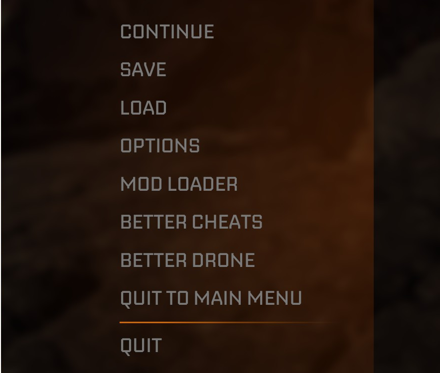
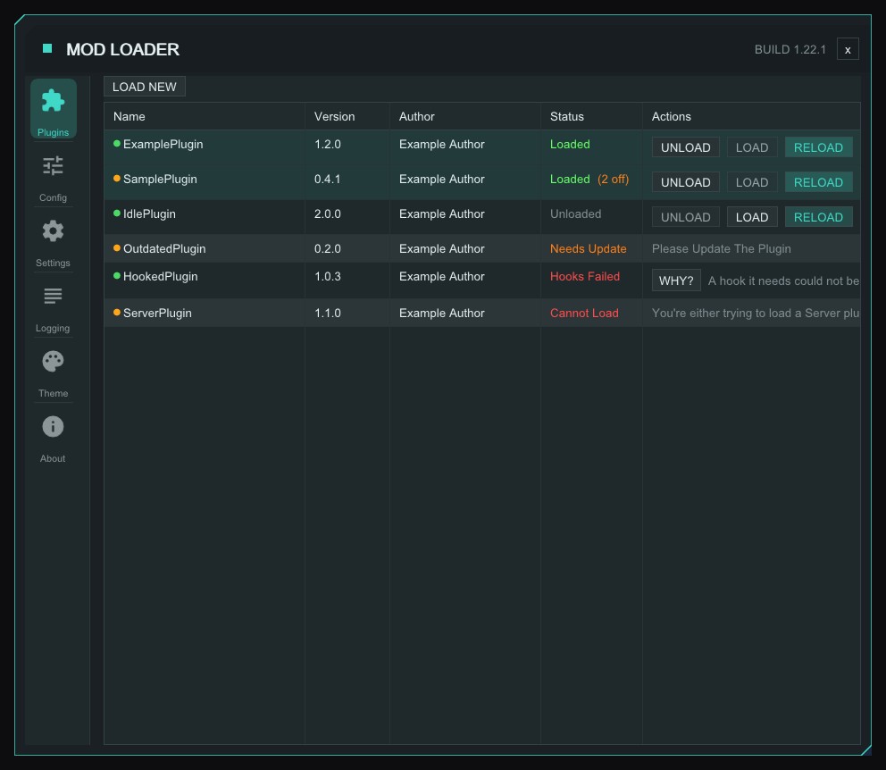
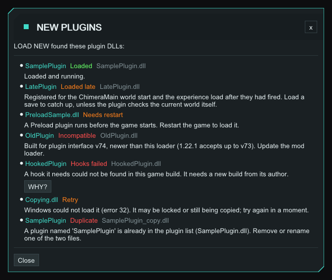
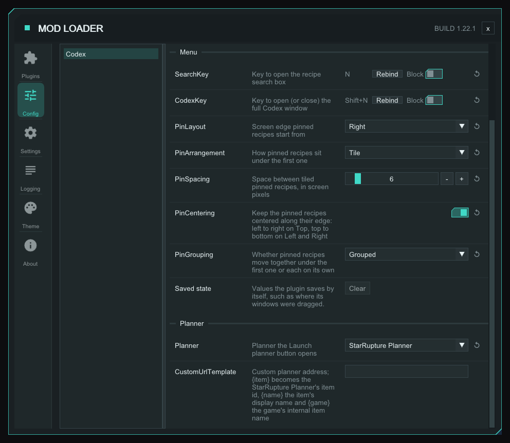
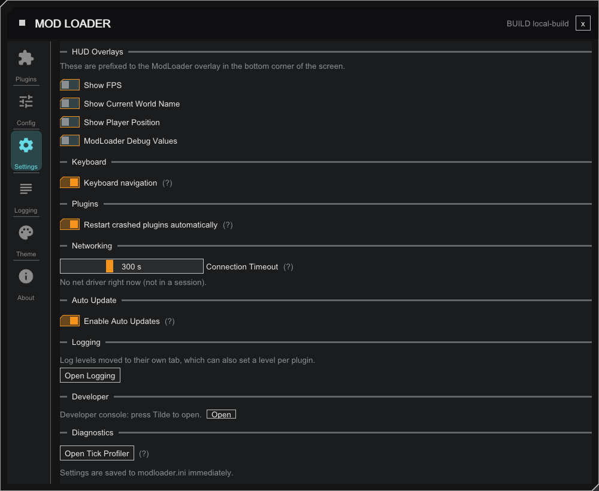
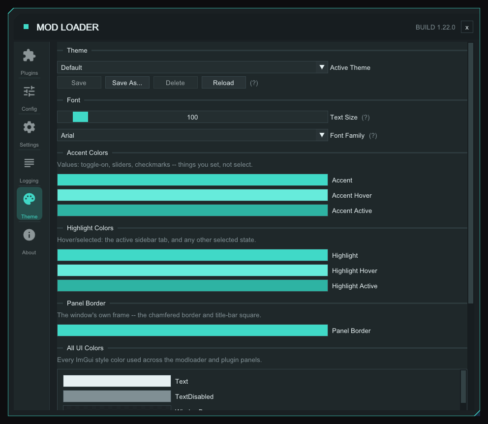
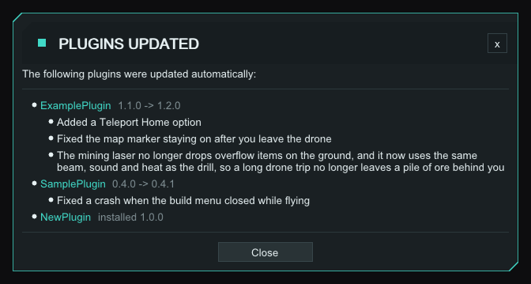
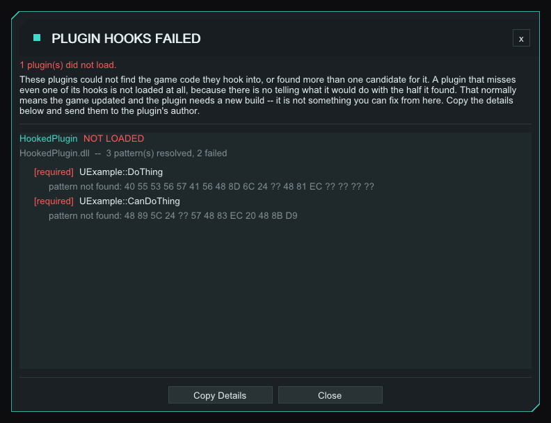
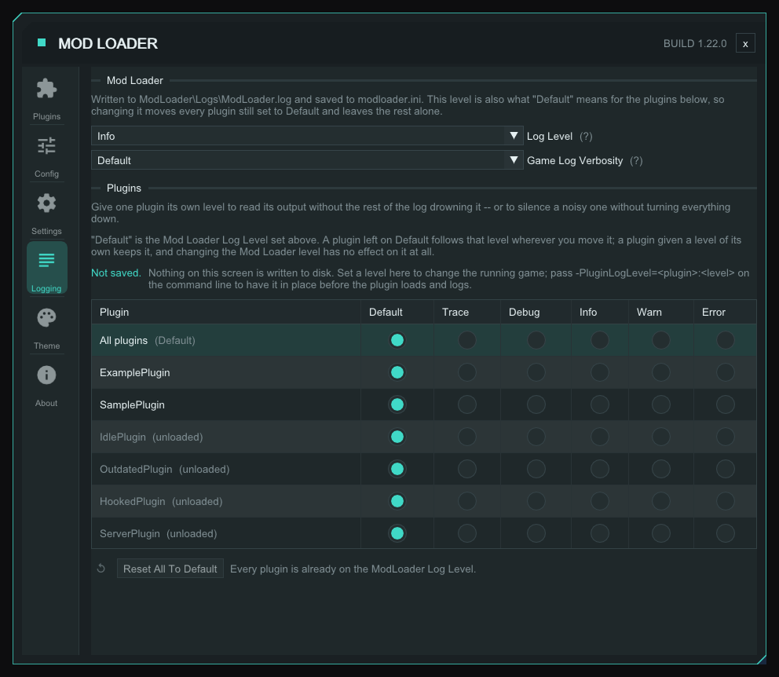

# StarRupture ModLoader
[](https://github.com/AlienXAXS/StarRupture-ModLoader/actions/workflows/release.yml)

A plugin-based mod loader for [StarRupture](https://store.steampowered.com/app/1631270/StarRupture/). Loads automatically via DLL proxy injection — no game files are modified.

Like this project? Give it a star here on GitHub!

---

## Discord

[Join our Discord server](https://discord.gg/G5a4GYsvrz) to chat about the mod loader and plugins.

Found a bug? [Report it on GitHub](https://github.com/AlienXAXS/StarRupture-ModLoader/issues) and attach your `ModLoader.log` (in `<game>\StarRupture\Binaries\Win64\ModLoader\Logs\`).

---

## Installation

### 1. Download the right ZIP

Two builds are published on the [releases page](https://github.com/AlienXAXS/StarRupture-ModLoader/releases):

| ZIP | Use for |
|---|---|
| `StarRupture-ModLoader-Client-*.zip` | Playing the game |
| `StarRupture-ModLoader-Server-*.zip` | Running a dedicated server |

### 2. Extract into the game's binary folder

That's the folder containing `StarRuptureGameSteam-Win64-Shipping.exe`, for example:

```
StarRupture\Binaries\Win64\
```

The ZIP is already laid out correctly, so extract it **directly into that folder** — no subfolders
need creating by hand. Afterwards you should see:

```
StarRupture\Binaries\Win64\
├── StarRuptureGameSteam-Win64-Shipping.exe
├── dwmapi.dll                        ← the proxy the game loads
└── ModLoader\
    ├── StarRupture-ModLoader-Core.dll   ← the mod loader itself
    ├── StarRupture-ImGui.dll            ← client builds only
    ├── StarRupture-ModLoader-Updater.exe  ← client builds only, offers mod loader updates
    ├── modloader.ini                    ← created on first launch
    ├── Logs\                            ← created on first launch
    ├── Plugins\                         ← put plugin DLLs here
    └── Preload\                         ← put preload plugin DLLs here
```

Everything the mod loader owns lives under `ModLoader\`; `dwmapi.dll` is the only file that sits
next to the game executable.

### 3. Launch as normal

The mod loader initialises automatically via `dwmapi.dll`. No game files are modified.

**Linux users:** the mod will not load unless the environment variable `WINEDLLOVERRIDES` is set to
`dwmapi=n,b`.

---

## Installing Plugins

The mod loader ships with no plugins — download the ones you want and drop their `.dll` into
`Binaries\Win64\ModLoader\Plugins\`. Client plugins only load on a client, server plugins only on
a dedicated server; the mod loader window says so if you get one the wrong way round.

**Plugins are disabled by default.** The first time the game runs with a plugin present, a config
file is generated for it. To enable it:

1. Run the game once, then close it.
2. Open `Binaries\Win64\ModLoader\Plugins\config\`.
3. Open the `.ini` named after the plugin.
4. Set `Enabled=1` and save.
5. Launch again — the plugin is now active.

Repeat for each plugin you want to use. On a client you can do all of this from the mod loader
window instead, without editing files.

If a plugin ships a `.json` file alongside its `.dll`, it can update itself: the mod loader checks
for a new version at startup and downloads it. The **Plugins** tab marks those with a green dot
(amber means the plugin has no update manifest and has to be updated by hand). Auto-updating can be
turned off in the **Settings** tab.

---

## The Mod Loader Window (client)

- **F2** (rebindable: `OpenKey` under `[UI]` in `modloader.ini`) opens it. So does **MOD LOADER** in the game's main and pause menus, below OPTIONS.
- **Esc** closes it. <sup>[✦](#msantoro12)</sup>
- **1** to **5** open Plugins, Config, Settings, Logging and Theme while the window has the focus. They
  do nothing while a text box, a slider drag or a keybind capture is taking keys. <sup>[✦](#msantoro12)</sup>
- **Tab**, **Shift+Tab** and the arrow keys move between buttons and fields in this window and in
  plugin windows, **Space** or **Enter** uses the one picked. It runs only while a window is open, and
  **Keyboard navigation** in the **Settings** tab turns it off. <sup>[✦](#msantoro12)</sup>
- The loader and plugin windows are drawn into the frames that frame generation makes, so they do not
  flicker, and frame generation stays on while one is open. <sup>[✦](#msantoro12)</sup>
- **`~`** (tilde; rebindable: `OpenKey` under `[Console]` in `modloader.ini`) opens the [developer console](#developer-console).



The tabs down the left are **Plugins**, **Config**, **Settings**, **Logging**, **Theme** and **About**
(the build tag and the plugins currently loaded). The menu row is set in
[`modloader.ini`](#modloaderini). A splash window shows startup progress. In the main menu a
bottom-left banner shows the build tag, plugin count and open key, plus a red note when an update
is available.

### Plugins tab



- **LOAD NEW**, beside the window title, picks up plugin DLLs added to the Plugins folder since the
  game started, and a popup lists each one with what to do next. <sup>[✦](#msantoro12)</sup>

  

  - **Loaded** means nothing it registered for in PluginInit had already fired (save-loaded
    callbacks are not tracked). **Loaded late** registered for a world or experience start that had
    already fired; load a save to catch it up (the any-world start also re-fires on returning to
    the main menu), unless the plugin checks the current world itself.
  - **Needs restart** is a new DLL in the Preload folder, which only loads at game start.
  - **Incompatible** is a plugin built for a newer plugin interface than this loader's (update the mod
    loader), or, on a game build other than the one the plugin was built for, says the plugin needs an
    update (see [Game updates](#game-updates)). A plugin is never refused for an older interface; one from
    before interface v70 counts as built for a game build before CL-127004.
  - **Hooks failed** has a **WHY?** button for the [report](#pop-up-windows).
  - **Retry** is a DLL Windows could not open yet, usually still being copied or locked.
  - **Duplicate** is a plugin whose name is already in the list.
  - The `rescan` console command prints the same lines.
- Click a loaded plugin's row to open its page on the Config tab. The buttons on the row work as before. <sup>[✦](#msantoro12)</sup>
- **Cannot Load** is a server plugin on a client, or the reverse.
- **Needs Update** names the side that is behind: the plugin or the mod loader.
- **WHY?** on a Hooks Failed row reopens the [report](#pop-up-windows).
- **Loaded (2 off)** is a plugin that runs with two of its features turned off because a game
  update moved something they need. Hover the name or the count to see which. <sup>[✦](#msantoro12)</sup>
- **Crashed** is a plugin that faulted in its own code during one of its callbacks: a tick, an
  overlay panel or widget, a game event, a keybind, a console command, a network or HTTP handler.
  The loader switches that plugin off and the game keeps running. Hover the status for the fault
  code and the callback. Nothing calls into the plugin again until it is reloaded or unloaded, and
  **RELOAD** brings it back fresh. Detours it placed on game functions and threads of its own are
  not switched off, so restart the game if it still misbehaves. <sup>[✦](#msantoro12)</sup>
  - A fault in game or mod loader code still crashes the game, even when a plugin's callback called
    into it: carrying on past half-finished game code could freeze the game. The log names the
    plugin and the callback it happened under.
  - On a server, a crashed HTTP request filter denies every request until its plugin is reloaded.
  - A toast in the bottom right corner names the plugin and the callback, fades after about 7
    seconds, and stacks when several plugins crash. About 3 seconds later the loader reloads the
    plugin on its own, the same as **RELOAD**, if its [load and unload settings](#load-and-unload-settings)
    allow it: **Any time** restarts after the short wait, **Main menu only** waits until you are at the main menu,
    and a plugin that needs a game restart stays off (the toast says so). Each plugin restarts
    automatically at most 3 times a session; a fourth crash leaves it off until the game restarts.
    Every crash, planned restart, restart and give-up is in `ModLoader.log`. On a dedicated server
    there is no toast and no setting: restarts are always on, under the same rules. Nothing restarts once the game starts to exit.
    <sup>[✦](#msantoro12)</sup>
- **Return to the main menu to reload this plugin**, **This plugin requires a game restart**, **Unload
  not supported** and **Unload blocked: ...** take the place of the buttons the loader would refuse.
  They come from the plugin's own [load and unload settings](#load-and-unload-settings).
  <sup>[✦](#msantoro12)</sup>
- Unload removes the panels, widgets and callbacks the plugin registered, even ones it left
  behind.
- If the overlay is still drawing its panel after about a second, the unload is skipped and the log
  says so. The plugin is shut down and shows **Unloaded**, but its DLL stays mapped. **LOAD** or
  **RELOAD** retries.

### Load and unload settings

A plugin can say when it may be loaded and unloaded while the game runs. It declares one setting for
loading and one for unloading, each **ANYTIME**, **MENU** or **RESTART**; a reload is an unload and a
load, so it needs both. <sup>[✦](#msantoro12)</sup>

| Setting | Load | Unload (and reload) |
|---|---|---|
| ANYTIME | Any time. The default, and what every plugin built before this reads as | Any time |
| MENU | Only while no game world is running (the splash or the main menu) | Only while no game world is running |
| RESTART | Only when the loader loads plugins at startup | Never at run time: **Unload not supported** |

The loader refuses before it touches the plugin, from every path: the buttons, **LOAD NEW**, the
`reload`, `unload`, `load` and `rescan` commands (including `all`) and a command run through RCON or
Server Utility. The reason is on the plugin's row and in the command's output:

- MENU in a world: "Return to the main menu to reload this plugin".
- RESTART: "This plugin requires a game restart".

A plugin can also mark itself busy for a while, such as MiniMap with GPU work in flight. The loader
then refuses an unload or a reload with **Unload blocked: &lt;reason&gt;**, and the plugin keeps running.
It never calls the plugin to ask. Game shutdown ignores all of it.

A world is running from the moment ChimeraMain begins play until it ends; the main menu and the
splash have none. How a plugin declares these is in the SDK's `PluginDevelopment.md`.

### Config tab



- **Ctrl+Click** a slider to type an exact value.
- **-** and **+** beside a slider step it by 1 (decimal: 1% of range). **Ctrl** steps 10%. They
  repeat while held. <sup>[✦](#msantoro12)</sup>
- A number field applies as you type; a text field on **Enter** or when you click away.
- **Rebind** waits for the next key; hold Ctrl, Shift or Alt for a combo, **Esc** cancels. No
  keybind fires meanwhile.
- Press and release a modifier alone to bind just that modifier. <sup>[✦](#msantoro12)</sup>
- **Block** stops the game also reacting to the combo.
- A setting with a fixed set of choices is a dropdown. <sup>[✦](#msantoro12)</sup>
- A setting that belongs to a turned-off feature is greyed out. Hover it for the reason; its value
  is kept, and it works again when the feature does. <sup>[✦](#msantoro12)</sup>
- **Saved state** stands for values a plugin keeps by itself, such as where its windows were
  dragged. **Clear** puts them back to their defaults. <sup>[✦](#msantoro12)</sup>
- The reset arrow restores the default. A plugin's `[General] Enabled` has none, nor does a
  setting without a default.
- The plugin hears each change as you make it. The `.ini` is written when you let go of a slider
  or confirm a value. A value a plugin writes to its own `.ini` shows at once, and Reload picks up
  settings the new build added.

### Settings tab



- The HUD toggles share one draggable box. It starts at the top left and remembers where you put
  it. **ModLoader Debug Values** adds input details to it ([Troubleshooting](#troubleshooting)).
- **Keyboard navigation** (on by default) lets Tab, the arrow keys and Space or Enter drive the loader
  and plugin windows while they are open. <sup>[✦](#msantoro12)</sup>
- **Restart crashed plugins automatically** (on by default) reloads a [crashed](#plugins-tab) plugin
  a few seconds after its crash toast. Turn it off to restart them yourself with **RELOAD**.
  <sup>[✦](#msantoro12)</sup>
- **Connection Timeout**: see [Net timeouts](#net-timeouts).
- **Enable Auto Updates** takes effect next launch. A mod loader update asks Yes or No first; a No
  is remembered for that version.
- **Open Tick Profiler**: **Log Tick Stutters** and **Stack Sample Stutters** reset on restart.
  Stack sampling needs stutter logging on and is the heavier of the two.

### Theme tab



- **Save**, **Save As...**, **Delete** and **Reload** manage `ModLoader\Themes\<name>.ini`; share the
  file to share the theme. **Default** and **Star Rupture** are built in and read-only: **Save As...**
  makes an editable copy. <sup>[✦](#msantoro12)</sup>
- Colour edits apply at once; **Save** keeps them and **Reload** discards them.
- **Font Family** only lists fonts found on your PC. Microsoft YaHei, Meiryo, Malgun Gothic and
  Arial + CJK add Chinese, Japanese or Korean text.

### Developer console

**`~`** opens it over the top of the screen; it takes game input while open. Up and Down walk your
history. A line the mod loader does not know goes to the game's own console; prefix `!` to send it
there only. See [Console commands](#console-commands).

### Pop-up windows

**Plugins Updated** appears once at the main menu after an automatic plugin update. It lists what
changed in each plugin when the plugin's release ships notes. Plugins whose notes are word for
word the same share one line (the names joined, in the accent colour) with the notes shown once, and
that line leaves out the versions. <sup>[✦](#msantoro12)</sup>



**Plugin Hooks Failed** appears when a plugin did not load because a hook is missing, and again
when a later load or reload adds one. **Copy Details** puts the report on the clipboard for a bug
report. **WHY?** reopens it; `hookfailures` prints the same list.

When a plugin loads with a feature turned off, the same window opens as **Plugin Features Off**,
with a short list at the top: one line for each plugin and feature. The detail below it is for the
plugin's author. <sup>[✦](#msantoro12)</sup>



---

## The Server Console (dedicated server)

A dedicated server has no UI. Launch it with `-console` for a console window with the same
[commands](#console-commands). Tab completes, Up and Down walk your history, **Ctrl+C** or
**Ctrl+U** clears the line. `stop` shuts the server down. `close` closes the window and leaves the
server running; the X ends the server. `exit` and `quit` only print a reminder of those two.

---

## Console commands

On the server console and the client's [developer console](#developer-console). `<target>` is a
plugin name, its index from `plugins`, or `all`. Plugins can add their own commands, which show up
in `help` ([Console.md](Console.md)).

| Command | Also | Does |
|---|---|---|
| `help [command]` | `?`, `commands` | List commands, or explain one |
| `plugins` | `list`, `mods` | List every plugin, its version and state (`Loaded (2 off)` when features are turned off) |
| `reload <target>` | | Shut a plugin down, free its DLL and load it again |
| `unload <target>` | | Shut a plugin down and free its DLL |
| `load <target>` | | Load a plugin that is unloaded |
| `rescan` | `scan` | Load plugin DLLs added to `Plugins\` since startup |
| `hookfailures` | `hooks` | List plugins whose hook patterns did not resolve |
| `hooklist` | | List every detoured address and the plugins sharing it |
| `preload` | `preloads` | Show what happened to the DLLs in `Preload\` at startup |
| `version` | `ver` | Show the mod loader build and plugin interface versions |
| `pak <action>` | `paks` | Mount and unmount paks, and load, spawn or preview assets from them. Actions: `list` (or `ls`), `mount <path> [order]`, `unmount <n or path>`, `load <path>`, `loadclass <path>`, `spawn <class> [x y z]`, `spawnmesh <mesh> [x y z]`, and on a client `widget <class> [zorder]` or `widget close` |
| `loglevel [level]` | `log` | Show or change the log level. Runtime only |
| `loglevel <plugin or *> <level or default>` | | The same for one plugin, or all |
| `clear` | `cls` | Wipe the scrollback |
| `clients [n]` | `who` | List connected clients and the plugins they reported |
| `nettest [bytes]` | | Round-trip a payload through the server to test fragmentation |
| `stop [force]` | `shutdown` | Shut the server down cleanly, or at once with `force`. Server builds only |

`reload`, `unload` and `load` print why when the plugin's [load and unload settings](#load-and-unload-settings)
or busy reason refuse it, and `plugins` lists the reason under that plugin.

---

## Log Levels

The mod loader writes to `Binaries\Win64\ModLoader\Logs\ModLoader.log`, keeping the last ten runs.
Open the mod loader window and go to the **Logging** tab to change how much detail it records:

- **Log Level** — the mod loader's own output. Saved, so it applies on every launch.
- **Game Log Verbosity** — the game's own log categories, written to `StarRupture.log`. Also saved.
- **Per plugin** — a grid with one row per plugin, and an **All plugins** row that sets them together.
  Turn a single plugin up to read its output without the rest of the log burying it, or down to
  silence a noisy one without quieting everything else. `Default` means "follow the Log Level above".
  Unloaded plugins show as `(unloaded)`.



Per-plugin levels are **not saved** — every plugin is back on `Default` next launch.

### Setting a plugin's level before the game starts

A plugin that logs heavily while the game is still loading has already filled the log by the time
you can open the Logging tab. Add a launch option to have the level in place before it loads.
In Steam: right-click the game, *Properties* → *General* → *Launch Options*.

```
-PluginLogLevel=<plugin>:<level>
```

`<plugin>` is the name as it appears in `[Plugin:NAME]` in the log — the same name the Logging tab
shows. `<level>` is `trace`, `debug`, `info`, `warn`, `error`, or `default`.

Several at once, comma separated:

```
-PluginLogLevel=NoisyPlugin:error,OtherPlugin:trace
```

`*` sets the level for every plugin you have not named:

```
-PluginLogLevel=*:warn,PluginImDebugging:trace
```

Quote the whole option if a plugin name contains a space:

```
-PluginLogLevel="My Plugin:error"
```

The Logging tab shows when a launch option is in effect, and *Reset All To Default* clears it for
the rest of the session.

---

## Developing Your Own Plugins

Use the [StarRupture-Plugin-SDK](https://github.com/AlienXAXS/StarRupture-Plugin-SDK) — it has everything you need (headers, UE5 SDK, an example plugin, and a pre-built `dwmapi.dll`) without requiring a fork of this repo.

A plugin declares its settings as a config schema (string, integer, float, boolean, keybind or a
choice from a list, with an optional range), plus any state it saves by itself; the
[Config tab](#config-tab) draws it. It can also name each feature it needs (interface v73), so one
missing game function or member turns off that feature and not the whole plugin, and look game
functions and members up by key in the loader's version map ([VersionMap.md](VersionMap.md)).
<sup>[✦](#msantoro12)</sup>

| Guide | Covers |
|---|---|
| [Console.md](Console.md) | Console commands, running command lines from code (v63; `ExecuteWithEngine` v69). All builds |
| [GameMenu.md](GameMenu.md) | Rows in the main and pause menus (v64), whether the pause menu is open (v71), the game's UI state and its change callback (v74). Client |
| [HttpServer.md](HttpServer.md) | HTTP from the game server's listener (v22). Server |
| [ImGui_Dev.md](ImGui_Dev.md) | Panels, always-on widgets, config-change notifications, keybinds, mouse wheel (v70), widgets that opt in to the mouse over the pause menu and other cursor screens and keys while typing (v71), sizing a popup (v74), title-bar buttons and collapsing a panel, and widgets that take the mouse over a game menu only where no menu widget is under the cursor (v75), and the full ImGui function table. Client |
| [MaterialIcons.md](MaterialIcons.md) | The 2188 bundled icons |
| [Networking.md](Networking.md) | Messages between server and clients, `hooks->Network`. Client and server |
| [PakLoading.md](PakLoading.md) | Mounting `.pak` files, spawning their assets (v67). All builds |
| [Preload.md](Preload.md) | Preload plugins, below |
| [Tests/README.md](Tests/README.md) | Manual test projects. CI does not build them |

Still unregister panels, widgets and callbacks in `PluginShutdown`, though the loader
[removes them on unload](#plugins-tab). Check the thread before touching game objects there: it runs
on the game thread from **RELOAD** and also at process exit.

The current world, for the loader and for `PluginSdkRuntime::GetWorld()` in the SDK, is the world
in the game's viewport, not the engine's `GWorld` global. A plugin that builds a world of its own
(a preview or capture world) can leave `GWorld` pointing at that world, and plugins reading it then
wait for a world that never comes. The world-start events pass the world that began play.
<sup>[✦](#msantoro12)</sup>

A popup a plugin opens with `BeginPopupModal` no longer has to collapse into a narrow strip (interface
v74): `SetNextWindowSize` and `SetNextWindowSizeConstraints` size the window that opens next, with
named `PluginCond_*` conditions and `PluginWindowFlags_AlwaysAutoResize`. The recommended popup is
auto-sized with a minimum width and not saved to the ini; ImGui centres a modal on the screen itself:

```cpp
// Open it once, from a button: imgui->OpenPopup("Confirm##myplugin");
imgui->SetNextWindowSizeConstraints(360.0f, 0.0f, FLT_MAX, FLT_MAX);   // minimum width; needs <cfloat>
if (imgui->BeginPopupModal("Confirm##myplugin", nullptr,
        PluginWindowFlags_AlwaysAutoResize | PluginWindowFlags_NoSavedSettings))
{
    imgui->TextWrapped("A long message that wraps inside the minimum width.");
    if (imgui->Button("OK")) imgui->CloseCurrentPopup();
    imgui->EndPopup();
}
```

For a fixed width with an auto height, call `SetNextWindowSize(540.0f, 0.0f, PluginCond_Always)` before
`BeginPopupModal`: it overrides `PluginWindowFlags_AlwaysAutoResize` on the axis it sets, and a 0 keeps
that axis auto-fitted. To give a window a fixed size instead, leave out `PluginWindowFlags_AlwaysAutoResize`
and set both axes.

A plugin that declares v74 needs a mod loader that supports it; an older loader shows it as needing a
mod loader update. One that must also run on a v73 loader declares 73 and does not call them.
<sup>[✦](#msantoro12)</sup>

The loader keeps the game's UI state for plugins (interface v74): whether a gameplay world is
running, the pause menu, the game's mouse cursor, any menu, and the map, inventory, build menu and
station screens. `RegisterOnUIStateChanged` calls you on the game thread when a bit you asked for
changes; `GameMenu->GetUIState()` reads the gameplay, pause-menu and cursor bits from any thread. Ignore bits you do not know: later
loaders may add some. See [GameMenu.md](GameMenu.md). The menu classes follow BetterDrone's
menu-layer read and the class list in Kian369's MiniMap.
<sup>[✦](#msantoro12)</sup>

### Reloading a plugin from a script

To try a new build without pressing **RELOAD**, turn on `[Developer] RemoteReload=1` in `modloader.ini`
(off by default; the loader logs a warning at launch when it is on) and write a plugin's name, or its
DLL file name, to `ModLoader\remote_reload.txt`: one per line, up to 16, blank lines and lines starting
with `#` ignored. Within about a second the loader takes the file and reloads each plugin on the game
thread, the same reload the **RELOAD** button runs, so your `PluginShutdown` and `PluginInit` run as
usual and the plugin's load and unload settings still apply. Each name gets one line in `ModLoader.log`:

```
[RemoteReload] MyPlugin reloaded OK v1.2.0
[RemoteReload] MyPlugin reload failed: <why>
```

Copy the new DLL into `ModLoader\Plugins\` first, then create the request: write it under another
name and rename it to `remote_reload.txt`, so the loader never reads half a file. A name the loader has
no record of is a failure line; a plugin dropped in after startup needs **LOAD NEW** first.
<sup>[✦](#msantoro12)</sup>

### Preload plugins

A **preload plugin** is a DLL in `ModLoader\Preload\` that runs *before the game executable's
entry point*, so it can patch code the engine touches on its way up. There is no engine at that
point — no `GMalloc`, no `UObject`, no config — so a preload plugin resolves
patterns, patches bytes, installs detours, and returns. Its detours fire later, once the game is
running.

One failing can never stop the game launching: it is unloaded, reported, and the game boots
without it. That is deliberately the opposite of the loader's own pattern preflight, and it is
what makes an outdated preload plugin safe to leave installed across a game update.

- SDK and starter project: [StarRupture-PreLoadPlugin-SDK](https://github.com/AlienXAXS/StarRupture-PreLoadPlugin-SDK)
- Design and rules: [Preload.md](Preload.md)

If you only need engine events, UI, config or networking, use an ordinary plugin — you get
the whole API and you can hot-reload it while the game runs.

---

## Troubleshooting

| Problem | Solution |
|---|---|
| Nothing loads at all | `dwmapi.dll` must sit next to the game `.exe` with the `ModLoader\` folder beside it — not in a subfolder of its own. On Linux, set `WINEDLLOVERRIDES=dwmapi=n,b`. No `Logs\Proxy.log` at all means the game never loaded `dwmapi.dll`. |
| Plugins not loading | Make sure the DLLs are in `ModLoader\Plugins\` and `Enabled=1` is set in each plugin's `.ini`. The **Plugins** tab shows why a plugin was rejected: see its [statuses](#plugins-tab). |
| Preload plugin not running | Run `preload` in the console, or check the `[Preload]` lines in the log. A preload plugin that fails is skipped and the game starts without it. |
| Game will not start after adding a preload plugin | Launch with `-NoPreload`, or set `Enabled=0` under `[Preload]` in `modloader.ini`. The loader also skips any preload plugin that did not finish loading last launch, and says which it was. Delete `Preload\.state` to let it try again. |
| A dialog offers "Start Game Without ModLoader" | The game build changed or a scan pattern no longer matches. The mod loader stays off until it is updated. **Copy Details** has the report. `-SkipPatternValidation` overrides an ambiguous or wrong-kind pattern, not a missing one. |
| A dialog says the game has changed in a way that would break your plugins | At startup the mod loader checks that the game classes it and its plugins read are still laid out the way it was built for. A game update moved some of them. When what moved is read by only some loader features, only those features turn off; when it is read by every plugin, no plugins load this session: start the game without them, or quit until an update is out. The loader writes `ModLoader\compat-report-<CL>.json` (the game build, the executable's SHA-256 and what moved). It says whether only some features turned off or every plugin did, and is what a loader update is made from, so attach it to your report. |
| A plugin says "Needs an update to run on CL-..." | The plugin was built for another game build and does not declare that it takes its game data from the version map, so it would read this game's data where its own build had it. It loads on the build it names. Ask its author for an update. See [Game updates](#game-updates) and [VersionMap.md](VersionMap.md). |
| Logs / diagnostics | Check `ModLoader\Logs\ModLoader.log`. Raise the detail in the **Logging** tab, or set `Level=DEBUG` under `[Logging]` in `ModLoader\modloader.ini`. |
| One plugin is flooding the log | See [Log Levels](#log-levels) — turn that plugin down on its own, or use `-PluginLogLevel=` if it happens during startup. |
| The *game's* log is flooding on a dedicated server | Hundreds of `LogTemp` / `LogSkinnedMeshComp` warnings a second come from the game itself, not the mod loader. Server builds turn those two categories down to errors automatically; edit `GameLogCategories` under `[Logging]` in `ModLoader\modloader.ini` to change the list, or blank it to leave the game log alone. `-LogCmds=` has no effect on this build. |
| Game stops responding to input | Turn on *ModLoader Debug Values* in the **Settings** tab — it names the plugin holding input open. |
| Game freezes ("Not Responding") | Look near the end of `ModLoader\Logs\ModLoader.log` for a `[PluginWatchdog]` line. A plugin's tick or overlay draw callback (a panel or widget) still running after 5 seconds is named there, e.g. `SomePlugin.dll widget render has been running for 5016 ms`. Disable that plugin and report it to its author. |
| `ModLoader.log` has `its own pattern matches N times on this exe` for a plugin | The plugin loads, because the version map's row decides where its function is. But its own AOB pattern is not unique on this game build (N is 2 or more) or no longer found (N is 0), and a loader that has no row to use (a stock loader with no map, a dedicated server, or a build where none of the map's rows resolve) refuses a plugin whose pattern matches 0 or 2 or more places. Tell the plugin's author to make the pattern unique, or update it. |
| A plugin shows **Crashed** | It faulted in one of its callbacks and was switched off; the game kept running. `ModLoader.log` has the fault and a stack. Press **RELOAD** to run it again, and report the log lines to its author. |
| The game crashes | The mod loader's own dialog has **Copy Details** and buttons for `ModLoader.log` and `StarRupture.log`. Include them in a bug report. |
| Players dropped during a long map load | See [Net timeouts](#net-timeouts). Both ends need the mod loader. |

---

## Game updates

The mod loader carries a version map: for each game build it lists, where the functions and
game-class members it and its plugins read are. A build in the map runs with no loader update.
Plugins that declare they take their game data from the map (`PLUGIN_MAP_MIGRATED` in their
`PluginInfo`, see the [SDK guide](https://github.com/AlienXAXS/StarRupture-Plugin-SDK/blob/main/PluginDevelopment.md))
run on any listed build. A plugin that does not declare it loads only on the build it was compiled
against, and shows **Incompatible** on the others.

On a client build with `[AutoUpdate] Enabled` on, the loader can also read a newer map from a signed
file, so a new game build can be supported without a loader update. None is published yet. A server
build never reads one.
How the map is chosen, how the feed is fetched, signed and cached, how CI publishes it and what
each failure looks like is in [VersionMap.md](VersionMap.md).

At startup the loader also checks that the game classes it reads are laid out as it was built for. If a
game update changes a layout, only the features that read it are switched off, not every plugin. A plugin
that keeps the game's layouts compiled in, instead of taking them from the version map, is not loaded then.
It also checks that the game still calls ProcessEvent, which every plugin uses to run game functions, at the
place the plugins expect; if it does not, plugins are switched off the same way.

When the map's row decides where a plugin's function is, the loader still checks the plugin's own
AOB pattern against the running exe, once, and logs a warning if it matches 0 or 2 or more places.
The plugin still loads. The warning is there so a pattern that only works because the map covers
for it is caught on a development setup, not by the first player on a loader without the map's row.
<sup>[✦](#msantoro12)</sup>

## Net timeouts

A player can be dropped while the host loads a map. The host's game thread does not
tick during the load, so nothing is sent — not even keepalives — and the client sees
silence for the whole load. Against the engine's stock 60s connection timeout, a load
longer than that disconnects everyone still joining.

The mod loader raises both net timeouts to **300 seconds** by default. The connection
timeout has a slider in the **Settings** tab under *Networking*, which also shows what
the live net driver is actually using. Both keys are under `[Network]` in
[`modloader.ini`](#modloaderini).

Two things to know:

- **Both ends need it.** Each side times the other out against its own clock, so the
  side that gives up is the side that needs the higher value. A vanilla client cannot
  be helped by a modded host, and vice versa.
- **It is not free.** A genuinely dead connection — a crashed client, a pulled network
  cable — now holds its player slot for the full timeout instead of a minute.

This cannot be set from Steam launch options. The engine does read
`?ConnectionTimeout=` out of the URL it connects with, but there is no way to get an
option into that URL from outside the process in a shipping build.

---

## Command-line switches

| Switch | Effect |
|---|---|
| `-console`, `-mlconsole`, `-modloaderconsole` | Open the [console window](#the-server-console-dedicated-server). Works on a client too, without `stop` |
| `-PluginLogLevel=<plugin>:<level>` | Set plugin log levels before they load. See [Log Levels](#log-levels) |
| `-NoPreload` | Skip the preload phase |
| `-SkipPatternValidation` | Start even if a scan pattern is ambiguous or the wrong kind. It is not an ini key on purpose |

---

## modloader.ini

`ModLoader\modloader.ini`, created on first launch. **Default** is what a fresh file holds; where a
deleted key behaves differently, Notes says so. The Settings, Logging and Theme tabs write most of
these for you.

| Section | Key | Default | Notes |
|---|---|---|---|
| `[Logging]` | `Level` | `INFO` | `TRACE`, `DEBUG`, `INFO`, `WARN` or `ERROR`. `DEBUG` if you delete the key |
| | `EnableFile` | `1` | |
| | `FileName` | `ModLoader.log` | Written to `Logs\` |
| | `GameVerbosity` | `Default` | Set by the Logging tab |
| | `GameLogCategories` | `LogTemp Error,LogSkinnedMeshComp Error` | Servers only. `<category> <verbosity>` pairs, comma separated. Empty leaves the game log alone |
| `[UI]` | `Enabled` | `1` | `0` turns the overlay off |
| | `OpenKey` | `F2` | |
| | `GameMenuEntry` | `1` | `0` removes the **MOD LOADER** menu row |
| | `FontScale` | `1.00` | 0.75 to 5.00. Set by **Text Size** |
| | `FontFamily` | `Arial` | `Default` if Arial is not installed. Set by **Font Family** |
| | `Theme` | empty | Empty is `Default`, unless the file has an old `[ThemeColors]` block: that is saved as the `Custom` theme. Set by **Active Theme** |
| | `KeyboardNavigation` | `1` | `0` turns off Tab, arrow-key and Space or Enter navigation. Set by **Keyboard navigation** |
| `[Plugins]` | `RestartCrashed` | `1` | `0` stops crashed plugins restarting on their own. Set by **Restart crashed plugins automatically** |
| `[Input]` | `SuppressKeybindsWhileTyping` | `1` | Keybinds ignore keys typed into a game text box |
| `[Console]` | `OpenKey` | `Tilde` | |
| `[HUD]` | `ShowFPS`, `ShowWorldName`, `ShowPlayerPosition`, `ShowDebugValues` | `0` | The Settings toggles |
| `[Network]` | `ConnectionTimeout`, `InitialConnectTimeout` | `300.0` | Seconds, 1 to 3600; anything else logs a warning and uses 300. `0` keeps the engine default. See [Net timeouts](#net-timeouts) |
| `[AutoUpdate]` | `Enabled` | `1` | |
| | `ManifestUrl` | empty | Empty uses the built-in manifest |
| `[Preload]` | `Enabled` | `1` | |
| | `Disabled` | empty | Comma-separated DLL names to skip |
| `[UE4SS]` | `Enabled` | `0` | Load UE4SS before plugins. `1` if you delete the key |
| | `Path` | `ue4ss\ue4ss.dll` | Relative to the game executable |
| `[Developer]` | `RemoteReload` | `0` | `1` reloads the plugins named in `ModLoader\remote_reload.txt` without pressing **RELOAD**. For plugin authors; logs a warning at every launch. See [Reloading a plugin from a script](#reloading-a-plugin-from-a-script) |
| `[Debug]` | `ExportKnownGObjects` | `0` | Writes `known_gobjects_dump.txt` |
| | `DisablePluginVersionMap` | `0` | Client only. `1` gives plugins no rows from the loader's version map, so each uses its own patterns and rows, or its feature switches off. For testing a plugin's own locators; the loader keeps the map for itself. Logs a warning at every launch. See [VersionMap.md](VersionMap.md) |

Other files, all under `ModLoader\`:

| File | What |
|---|---|
| `Plugins\config\<plugin>.ini` | One per plugin |
| `Themes\<name>.ini` | Saved themes |
| `modloader_imgui.ini` | Window and HUD positions |
| `Logs\Proxy.log`, `Logs\AutoUpdate.log` | The `dwmapi.dll` proxy and the startup updater. Ten runs kept, as for `ModLoader.log` |
| `update_state.ini` | Versions the auto-updater has installed. Not for editing |
| `scan_cache.ini` | Pattern scan results for the current game exe, kept per ProductVersion, PE timestamp and image size. A file from an older loader is discarded and rebuilt on the first launch |
| `Preload\.state` | Marks a preload plugin that did not finish loading |

---

## Tools Used

- **[IDA Pro](https://hex-rays.com/)** by Hex-Rays — reverse engineering the game binary to find hook targets and AOB patterns
- **[Claude Code](https://claude.com/claude-code)** — AI coding assistant used throughout development

---

## Disclaimer

This is a modding tool for educational purposes. Use at your own risk. The authors are not responsible for any damage caused by using this software. While every effort is made to ensure save file compatibility across updates, this cannot be guaranteed.

---

**Game:** Star Rupture · **Engine:** Unreal Engine 5

---

## Credits

Original mod by [@AlienXAXS](https://github.com/AlienXAXS) ([AGNGaming](https://www.agngaming.com)).

Maintained by [@msantoro12](https://github.com/msantoro12).

Contributors:

- [@Mralexandresys](https://github.com/Mralexandresys)
- [@Wilhelm-af](https://github.com/Wilhelm-af)
- Kian369 ([@LetMeInside](https://github.com/LetMeInside))
- <a id="msantoro12"></a><sup>✦</sup> [@msantoro12](https://github.com/msantoro12), creator of [StarRupture Planner](https://starrupture.goodstuff.software)

Third-party:

- **[Dumper-7](https://github.com/Encryqed/Dumper-7)** — Unreal Engine SDK generation
- **[MinHook](https://github.com/TsudaKageyu/minhook)** — Function hooking library
- **[nlohmann/json](https://github.com/nlohmann/json)** — JSON parsing
