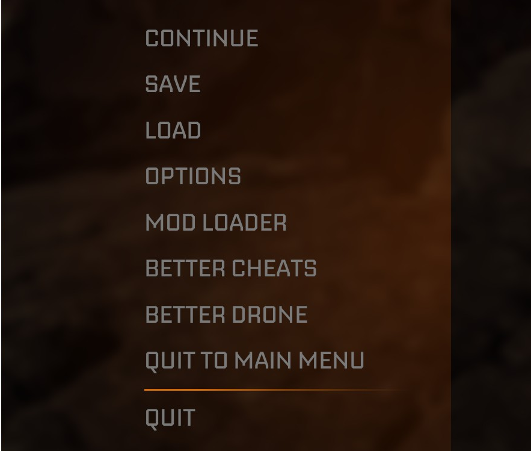
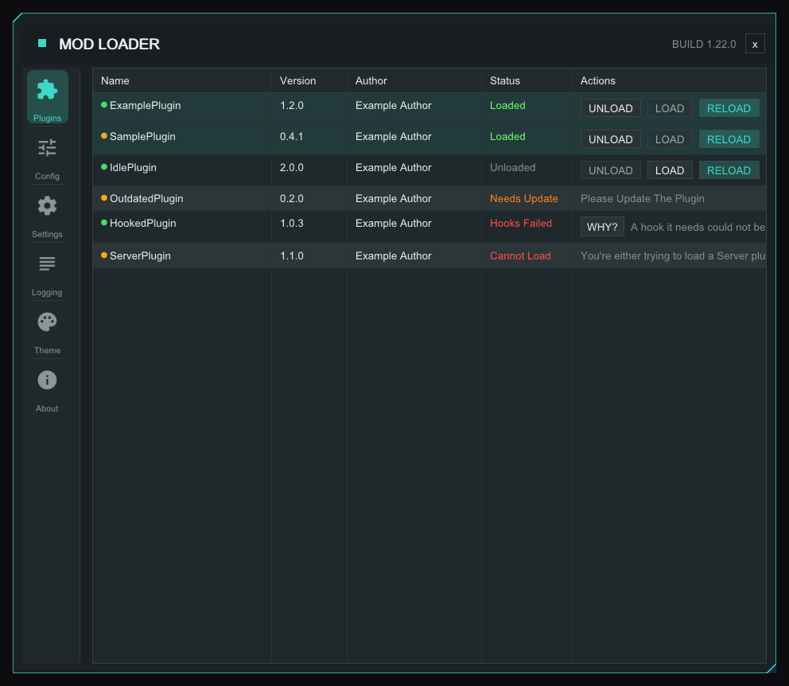
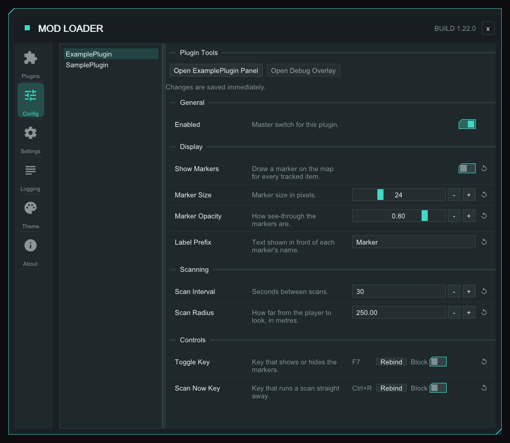
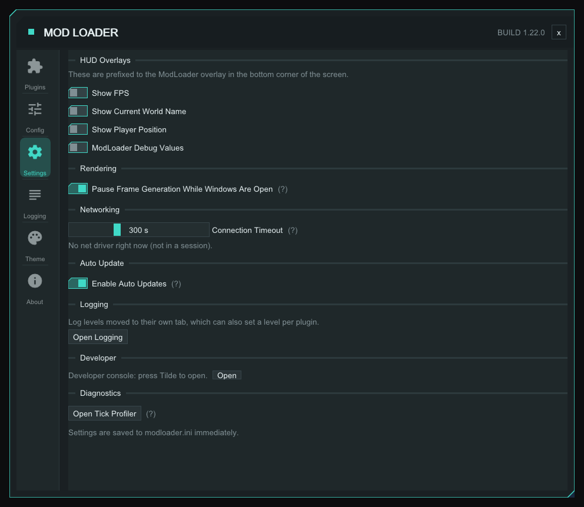
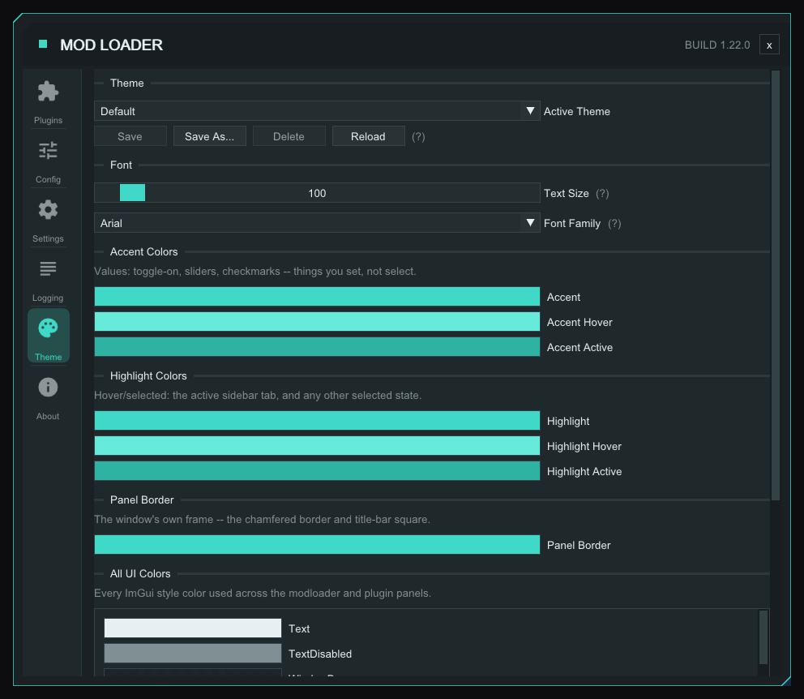
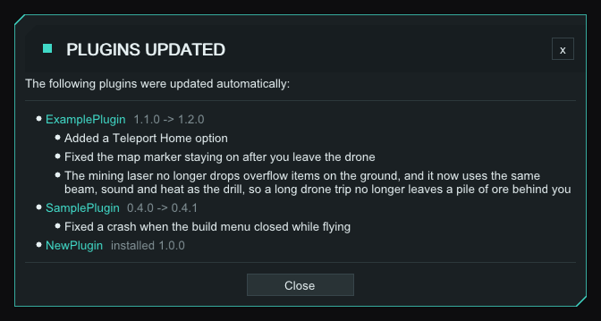
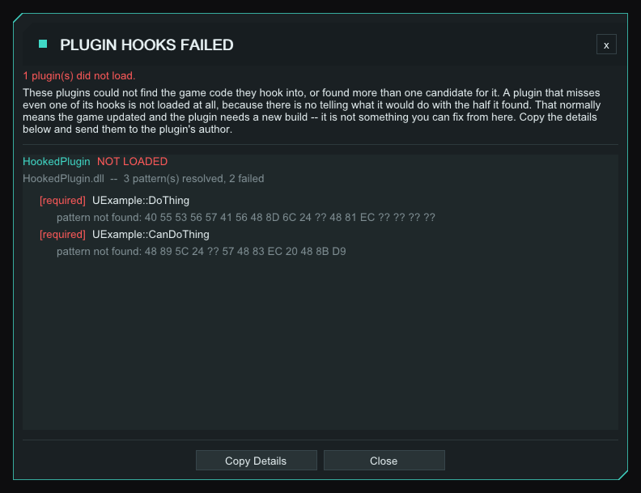
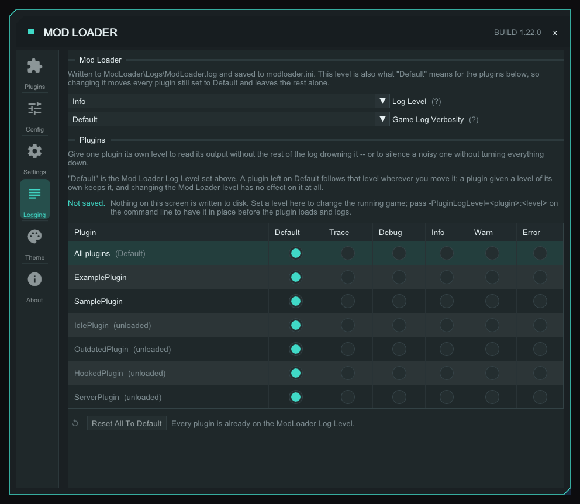

# StarRupture ModLoader
[](https://github.com/AlienXAXS/StarRupture-ModLoader/actions/workflows/release.yml)

A plugin-based mod loader for [StarRupture](https://store.steampowered.com/app/1631270/StarRupture/). Loads automatically via DLL proxy injection — no game files are modified.

Like this project? Give it a star here on GitHub!

---

## Discord

[Join our Discord server](https://discord.gg/G5a4GYsvrz) to chat about the mod loader and plugins.

---

## Installation

### 1. Download the right ZIP

Two builds are published on the [releases page](https://github.com/AlienXAXS/StarRupture-ModLoader/releases):

| ZIP | Use for |
|---|---|
| `StarRupture-ModLoader-Client-*.zip` | Playing the game |
| `StarRupture-ModLoader-Server-*.zip` | Running a dedicated server |

### 2. Extract into the game's binary folder

That's the folder containing `StarRuptureGameSteam-Win64-Shipping.exe`, for example:

```
StarRupture\Binaries\Win64\
```

The ZIP is already laid out correctly, so extract it **directly into that folder** — no subfolders
need creating by hand. Afterwards you should see:

```
StarRupture\Binaries\Win64\
├── StarRuptureGameSteam-Win64-Shipping.exe
├── dwmapi.dll                        ← the proxy the game loads
└── ModLoader\
    ├── StarRupture-ModLoader-Core.dll   ← the mod loader itself
    ├── StarRupture-ImGui.dll            ← client builds only
    ├── StarRupture-ModLoader-Updater.exe  ← client builds only, offers mod loader updates
    ├── modloader.ini                    ← created on first launch
    ├── Logs\                            ← created on first launch
    ├── Plugins\                         ← put plugin DLLs here
    └── Preload\                         ← put preload plugin DLLs here
```

Everything the mod loader owns lives under `ModLoader\`; `dwmapi.dll` is the only file that sits
next to the game executable.

### 3. Launch as normal

The mod loader initialises automatically via `dwmapi.dll`. No game files are modified.

**Linux users:** the mod will not load unless the environment variable `WINEDLLOVERRIDES` is set to
`dwmapi=n,b`.

---

## Installing Plugins

The mod loader ships with no plugins — download the ones you want and drop their `.dll` into
`Binaries\Win64\ModLoader\Plugins\`. Client plugins only load on a client, server plugins only on
a dedicated server; the mod loader window says so if you get one the wrong way round.

**Plugins are disabled by default.** The first time the game runs with a plugin present, a config
file is generated for it. To enable it:

1. Run the game once, then close it.
2. Open `Binaries\Win64\ModLoader\Plugins\config\`.
3. Open the `.ini` named after the plugin.
4. Set `Enabled=1` and save.
5. Launch again — the plugin is now active.

Repeat for each plugin you want to use. On a client you can do all of this from the mod loader
window instead, without editing files.

If a plugin ships a `.json` file alongside its `.dll`, it can update itself: the mod loader checks
for a new version at startup and downloads it. The **Plugins** tab marks those with a green dot
(amber means the plugin has no update manifest and has to be updated by hand). Auto-updating can be
turned off in the **Settings** tab.

---

## The Mod Loader Window (client)

- **F2** (rebindable: `OpenKey` under `[UI]` in `modloader.ini`) opens it. So does **MOD LOADER** in the game's main and pause menus, below OPTIONS.
- **Esc** closes it. <sup>[✦](#msantoro12)</sup>
- **`~`** (tilde; rebindable: `OpenKey` under `[Console]` in `modloader.ini`) opens the [developer console](#developer-console).



The tabs down the left are **Plugins**, **Config**, **Settings**, **Logging**, **Theme** and **About**
(the build tag and the plugins currently loaded). The menu row is set in
[`modloader.ini`](#modloaderini). A splash window shows startup progress. In the main menu a
bottom-left banner shows the build tag, plugin count and open key, plus a red note when an update
is available.

### Plugins tab



- **Cannot Load** is a server plugin on a client, or the reverse.
- **Needs Update** names the side that is behind: the plugin or the mod loader.
- **WHY?** on a Hooks Failed row reopens the [report](#pop-up-windows).
- Unload removes the panels, widgets and callbacks the plugin registered, even ones it left
  behind.
- If the overlay is still drawing its panel after about a second, the unload is skipped and the log
  says so. The plugin is shut down and shows **Unloaded**, but its DLL stays mapped. **LOAD** or
  **RELOAD** retries.

### Config tab



- **Ctrl+Click** a slider to type an exact value.
- **-** and **+** beside a slider step it by 1 (decimal: 1% of range). **Ctrl** steps 10%. They
  repeat while held. <sup>[✦](#msantoro12)</sup>
- A number field applies as you type; a text field on **Enter** or when you click away.
- **Rebind** waits for the next key; hold Ctrl, Shift or Alt for a combo, **Esc** cancels. No
  keybind fires meanwhile.
- Press and release a modifier alone to bind just that modifier. <sup>[✦](#msantoro12)</sup>
- **Block** stops the game also reacting to the combo.
- The reset arrow restores the default. A plugin's `[General] Enabled` has none, nor does a
  setting without a default.
- The plugin hears each change as you make it. The `.ini` is written when you let go of a slider
  or confirm a value. A value a plugin writes to its own `.ini` shows at once, and Reload picks up
  settings the new build added.

### Settings tab



- The HUD toggles share one draggable box. It starts at the top left and remembers where you put
  it. **ModLoader Debug Values** adds input details to it ([Troubleshooting](#troubleshooting)).
- **Pause Frame Generation While Windows Are Open** turns DLSS frame generation off while the mod
  loader window, the console or a plugin panel is open, and back on when they close. Its
  interpolated frames skip the overlay and flicker. <sup>[✦](#msantoro12)</sup>
- **Connection Timeout**: see [Net timeouts](#net-timeouts).
- **Enable Auto Updates** takes effect next launch. A mod loader update asks Yes or No first; a No
  is remembered for that version.
- **Open Tick Profiler**: **Log Tick Stutters** and **Stack Sample Stutters** reset on restart.
  Stack sampling needs stutter logging on and is the heavier of the two.

### Theme tab



- **Save**, **Save As...**, **Delete** and **Reload** manage `ModLoader\Themes\<name>.ini`; share the
  file to share the theme. **Default** and **Star Rupture** are built in and read-only: **Save As...**
  makes an editable copy. <sup>[✦](#msantoro12)</sup>
- Colour edits apply at once; **Save** keeps them and **Reload** discards them.
- **Font Family** only lists fonts found on your PC. Microsoft YaHei, Meiryo, Malgun Gothic and
  Arial + CJK add Chinese, Japanese or Korean text.

### Developer console

**`~`** opens it over the top of the screen; it takes game input while open. Up and Down walk your
history. A line the mod loader does not know goes to the game's own console; prefix `!` to send it
there only. See [Console commands](#console-commands).

### Pop-up windows

**Plugins Updated** appears once at the main menu after an automatic plugin update. It lists what
changed in each plugin when the plugin's release ships notes.



**Plugin Hooks Failed** appears when a plugin did not load because a hook is missing, and again
when a later load or reload adds one. **Copy Details** puts the report on the clipboard for a bug
report. **WHY?** reopens it; `hookfailures` prints the same list.



---

## The Server Console (dedicated server)

A dedicated server has no UI. Launch it with `-console` for a console window with the same
[commands](#console-commands). Tab completes, Up and Down walk your history, **Ctrl+C** or
**Ctrl+U** clears the line. `stop` shuts the server down. `close` closes the window and leaves the
server running; the X ends the server. `exit` and `quit` only print a reminder of those two.

---

## Console commands

On the server console and the client's [developer console](#developer-console). `<target>` is a
plugin name, its index from `plugins`, or `all`. Plugins can add their own commands, which show up
in `help` ([Console.md](Console.md)).

| Command | Also | Does |
|---|---|---|
| `help [command]` | `?`, `commands` | List commands, or explain one |
| `plugins` | `list`, `mods` | List every plugin, its version and state |
| `reload <target>` | | Shut a plugin down, free its DLL and load it again |
| `unload <target>` | | Shut a plugin down and free its DLL |
| `load <target>` | | Load a plugin that is unloaded |
| `rescan` | `scan` | Load plugin DLLs added to `Plugins\` since startup |
| `hookfailures` | `hooks` | List plugins whose hook patterns did not resolve |
| `hooklist` | | List every detoured address and the plugins sharing it |
| `preload` | `preloads` | Show what happened to the DLLs in `Preload\` at startup |
| `version` | `ver` | Show the mod loader build and plugin interface versions |
| `pak <action>` | `paks` | Mount and unmount paks, and load, spawn or preview assets from them. Actions: `list` (or `ls`), `mount <path> [order]`, `unmount <n or path>`, `load <path>`, `loadclass <path>`, `spawn <class> [x y z]`, `spawnmesh <mesh> [x y z]`, and on a client `widget <class> [zorder]` or `widget close` |
| `loglevel [level]` | `log` | Show or change the log level. Runtime only |
| `loglevel <plugin or *> <level or default>` | | The same for one plugin, or all |
| `clear` | `cls` | Wipe the scrollback |
| `clients [n]` | `who` | List connected clients and the plugins they reported |
| `nettest [bytes]` | | Round-trip a payload through the server to test fragmentation |
| `stop [force]` | `shutdown` | Shut the server down cleanly, or at once with `force`. Server builds only |

---

## Log Levels

The mod loader writes to `Binaries\Win64\ModLoader\Logs\ModLoader.log`, keeping the last ten runs.
Open the mod loader window and go to the **Logging** tab to change how much detail it records:

- **Log Level** — the mod loader's own output. Saved, so it applies on every launch.
- **Game Log Verbosity** — the game's own log categories, written to `StarRupture.log`. Also saved.
- **Per plugin** — a grid with one row per plugin, and an **All plugins** row that sets them together.
  Turn a single plugin up to read its output without the rest of the log burying it, or down to
  silence a noisy one without quieting everything else. `Default` means "follow the Log Level above".
  Unloaded plugins show as `(unloaded)`.



Per-plugin levels are **not saved** — every plugin is back on `Default` next launch.

### Setting a plugin's level before the game starts

A plugin that logs heavily while the game is still loading has already filled the log by the time
you can open the Logging tab. Add a launch option to have the level in place before it loads.
In Steam: right-click the game, *Properties* → *General* → *Launch Options*.

```
-PluginLogLevel=<plugin>:<level>
```

`<plugin>` is the name as it appears in `[Plugin:NAME]` in the log — the same name the Logging tab
shows. `<level>` is `trace`, `debug`, `info`, `warn`, `error`, or `default`.

Several at once, comma separated:

```
-PluginLogLevel=NoisyPlugin:error,OtherPlugin:trace
```

`*` sets the level for every plugin you have not named:

```
-PluginLogLevel=*:warn,PluginImDebugging:trace
```

Quote the whole option if a plugin name contains a space:

```
-PluginLogLevel="My Plugin:error"
```

The Logging tab shows when a launch option is in effect, and *Reset All To Default* clears it for
the rest of the session.

---

## Developing Your Own Plugins

Use the [StarRupture-Plugin-SDK](https://github.com/AlienXAXS/StarRupture-Plugin-SDK) — it has everything you need (headers, UE5 SDK, an example plugin, and a pre-built `dwmapi.dll`) without requiring a fork of this repo.

A plugin declares its settings as a config schema (string, integer, float, boolean or keybind, with
an optional range); the [Config tab](#config-tab) draws it.

| Guide | Covers |
|---|---|
| [Console.md](Console.md) | Console commands, running command lines from code (v63; `ExecuteWithEngine` v69). All builds |
| [GameMenu.md](GameMenu.md) | Rows in the main and pause menus (v64). Client |
| [HttpServer.md](HttpServer.md) | HTTP from the game server's listener (v22). Server |
| [ImGui_Dev.md](ImGui_Dev.md) | Panels, always-on widgets, config-change notifications, keybinds, mouse wheel (v70) and the full ImGui function table. Client |
| [MaterialIcons.md](MaterialIcons.md) | The 2188 bundled icons |
| [Networking.md](Networking.md) | Messages between server and clients, `hooks->Network`. Client and server |
| [PakLoading.md](PakLoading.md) | Mounting `.pak` files, spawning their assets (v67). All builds |
| [Preload.md](Preload.md) | Preload plugins, below |
| [Tests/README.md](Tests/README.md) | Manual test projects. CI does not build them |

Still unregister panels, widgets and callbacks in `PluginShutdown`, though the loader
[removes them on unload](#plugins-tab). Check the thread before touching game objects there: it runs
on the game thread from **RELOAD** and also at process exit.

### Preload plugins

A **preload plugin** is a DLL in `ModLoader\Preload\` that runs *before the game executable's
entry point*, so it can patch code the engine touches on its way up. There is no engine at that
point — no `GMalloc`, no `UObject`, no config — so a preload plugin resolves
patterns, patches bytes, installs detours, and returns. Its detours fire later, once the game is
running.

One failing can never stop the game launching: it is unloaded, reported, and the game boots
without it. That is deliberately the opposite of the loader's own pattern preflight, and it is
what makes an outdated preload plugin safe to leave installed across a game update.

- SDK and starter project: [StarRupture-PreLoadPlugin-SDK](https://github.com/AlienXAXS/StarRupture-PreLoadPlugin-SDK)
- Design and rules: [Preload.md](Preload.md)

If you only need engine events, UI, config or networking, use an ordinary plugin — you get
the whole API and you can hot-reload it while the game runs.

---

## Troubleshooting

| Problem | Solution |
|---|---|
| Nothing loads at all | `dwmapi.dll` must sit next to the game `.exe` with the `ModLoader\` folder beside it — not in a subfolder of its own. On Linux, set `WINEDLLOVERRIDES=dwmapi=n,b`. No `Logs\Proxy.log` at all means the game never loaded `dwmapi.dll`. |
| Plugins not loading | Make sure the DLLs are in `ModLoader\Plugins\` and `Enabled=1` is set in each plugin's `.ini`. The **Plugins** tab shows why a plugin was rejected: see its [statuses](#plugins-tab). |
| Preload plugin not running | Run `preload` in the console, or check the `[Preload]` lines in the log. A preload plugin that fails is skipped and the game starts without it. |
| Game will not start after adding a preload plugin | Launch with `-NoPreload`, or set `Enabled=0` under `[Preload]` in `modloader.ini`. The loader also skips any preload plugin that did not finish loading last launch, and says which it was. Delete `Preload\.state` to let it try again. |
| A dialog offers "Start Game Without ModLoader" | The game build changed or a scan pattern no longer matches. The mod loader stays off until it is updated. **Copy Details** has the report. `-SkipPatternValidation` overrides an ambiguous or wrong-kind pattern, not a missing one. |
| Logs / diagnostics | Check `ModLoader\Logs\ModLoader.log`. Raise the detail in the **Logging** tab, or set `Level=DEBUG` under `[Logging]` in `ModLoader\modloader.ini`. |
| One plugin is flooding the log | See [Log Levels](#log-levels) — turn that plugin down on its own, or use `-PluginLogLevel=` if it happens during startup. |
| The *game's* log is flooding on a dedicated server | Hundreds of `LogTemp` / `LogSkinnedMeshComp` warnings a second come from the game itself, not the mod loader. Server builds turn those two categories down to errors automatically; edit `GameLogCategories` under `[Logging]` in `ModLoader\modloader.ini` to change the list, or blank it to leave the game log alone. `-LogCmds=` has no effect on this build. |
| Game stops responding to input | Turn on *ModLoader Debug Values* in the **Settings** tab — it names the plugin holding input open. |
| The game crashes | The mod loader's own dialog has **Copy Details** and buttons for `ModLoader.log` and `StarRupture.log`. Include them in a bug report. |
| Players dropped during a long map load | See [Net timeouts](#net-timeouts). Both ends need the mod loader. |

---

## Net timeouts

A player can be dropped while the host loads a map. The host's game thread does not
tick during the load, so nothing is sent — not even keepalives — and the client sees
silence for the whole load. Against the engine's stock 60s connection timeout, a load
longer than that disconnects everyone still joining.

The mod loader raises both net timeouts to **300 seconds** by default. The connection
timeout has a slider in the **Settings** tab under *Networking*, which also shows what
the live net driver is actually using. Both keys are under `[Network]` in
[`modloader.ini`](#modloaderini).

Two things to know:

- **Both ends need it.** Each side times the other out against its own clock, so the
  side that gives up is the side that needs the higher value. A vanilla client cannot
  be helped by a modded host, and vice versa.
- **It is not free.** A genuinely dead connection — a crashed client, a pulled network
  cable — now holds its player slot for the full timeout instead of a minute.

This cannot be set from Steam launch options. The engine does read
`?ConnectionTimeout=` out of the URL it connects with, but there is no way to get an
option into that URL from outside the process in a shipping build.

---

## Command-line switches

| Switch | Effect |
|---|---|
| `-console`, `-mlconsole`, `-modloaderconsole` | Open the [console window](#the-server-console-dedicated-server). Works on a client too, without `stop` |
| `-PluginLogLevel=<plugin>:<level>` | Set plugin log levels before they load. See [Log Levels](#log-levels) |
| `-NoPreload` | Skip the preload phase |
| `-SkipPatternValidation` | Start even if a scan pattern is ambiguous or the wrong kind. It is not an ini key on purpose |

---

## modloader.ini

`ModLoader\modloader.ini`, created on first launch. **Default** is what a fresh file holds; where a
deleted key behaves differently, Notes says so. The Settings, Logging and Theme tabs write most of
these for you.

| Section | Key | Default | Notes |
|---|---|---|---|
| `[Logging]` | `Level` | `INFO` | `TRACE`, `DEBUG`, `INFO`, `WARN` or `ERROR`. `DEBUG` if you delete the key |
| | `EnableFile` | `1` | |
| | `FileName` | `ModLoader.log` | Written to `Logs\` |
| | `GameVerbosity` | `Default` | Set by the Logging tab |
| | `GameLogCategories` | `LogTemp Error,LogSkinnedMeshComp Error` | Servers only. `<category> <verbosity>` pairs, comma separated. Empty leaves the game log alone |
| `[UI]` | `Enabled` | `1` | `0` turns the overlay off |
| | `OpenKey` | `F2` | |
| | `GameMenuEntry` | `1` | `0` removes the **MOD LOADER** menu row |
| | `FontScale` | `1.00` | 0.75 to 5.00. Set by **Text Size** |
| | `FontFamily` | `Arial` | `Default` if Arial is not installed. Set by **Font Family** |
| | `Theme` | empty | Empty is `Default`, unless the file has an old `[ThemeColors]` block: that is saved as the `Custom` theme. Set by **Active Theme** |
| `[Input]` | `SuppressKeybindsWhileTyping` | `1` | Keybinds ignore keys typed into a game text box |
| `[Console]` | `OpenKey` | `Tilde` | |
| `[HUD]` | `ShowFPS`, `ShowWorldName`, `ShowPlayerPosition`, `ShowDebugValues` | `0` | The Settings toggles |
| `[Rendering]` | `PauseFrameGenWhileOpen` | `1` | |
| `[Network]` | `ConnectionTimeout`, `InitialConnectTimeout` | `300.0` | Seconds, 1 to 3600; anything else logs a warning and uses 300. `0` keeps the engine default. See [Net timeouts](#net-timeouts) |
| `[AutoUpdate]` | `Enabled` | `1` | |
| | `ManifestUrl` | empty | Empty uses the built-in manifest |
| `[Preload]` | `Enabled` | `1` | |
| | `Disabled` | empty | Comma-separated DLL names to skip |
| `[UE4SS]` | `Enabled` | `0` | Load UE4SS before plugins. `1` if you delete the key |
| | `Path` | `ue4ss\ue4ss.dll` | Relative to the game executable |
| `[Debug]` | `ExportKnownGObjects` | `0` | Writes `known_gobjects_dump.txt` |

Other files, all under `ModLoader\`:

| File | What |
|---|---|
| `Plugins\config\<plugin>.ini` | One per plugin |
| `Themes\<name>.ini` | Saved themes |
| `modloader_imgui.ini` | Window and HUD positions |
| `Logs\Proxy.log`, `Logs\AutoUpdate.log` | The `dwmapi.dll` proxy and the startup updater. Ten runs kept, as for `ModLoader.log` |
| `update_state.ini` | Versions the auto-updater has installed. Not for editing |
| `scan_cache.ini` | Pattern scan results for the current game version |
| `Preload\.state` | Marks a preload plugin that did not finish loading |

---

## Tools Used

- **[IDA Pro](https://hex-rays.com/)** by Hex-Rays — reverse engineering the game binary to find hook targets and AOB patterns
- **[Claude Code](https://claude.com/claude-code)** — AI coding assistant used throughout development

---

## Disclaimer

This is a modding tool for educational purposes. Use at your own risk. The authors are not responsible for any damage caused by using this software. While every effort is made to ensure save file compatibility across updates, this cannot be guaranteed.

---

**Game:** Star Rupture · **Engine:** Unreal Engine 5

---

## Credits

Original mod by [@AlienXAXS](https://github.com/AlienXAXS) ([AGNGaming](https://www.agngaming.com)).

Contributors:

- [@Mralexandresys](https://github.com/Mralexandresys)
- [@Wilhelm-af](https://github.com/Wilhelm-af)
- <a id="msantoro12"></a><sup>✦</sup> [@msantoro12](https://github.com/msantoro12), creator of [StarRupture Planner](https://starrupture.goodstuff.software)

Third-party:

- **[Dumper-7](https://github.com/Encryqed/Dumper-7)** — Unreal Engine SDK generation
- **[MinHook](https://github.com/TsudaKageyu/minhook)** — Function hooking library
- **[nlohmann/json](https://github.com/nlohmann/json)** — JSON parsing
